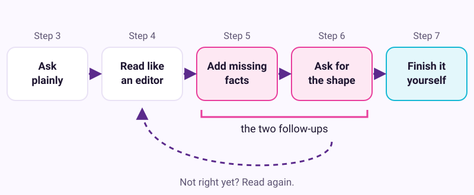
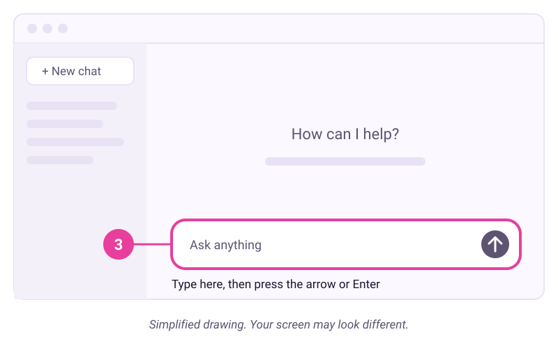

# Your first useful conversation with an AI assistant

Checked: November 2026 · Works on: ChatGPT Free, Claude Free or Gemini (free personal Google Account) · Time: 15 min
You need: a free account with one of those three apps, and one small, real task from your week. No coding, no paid plan.
Video version: [video script](video-script.md) (video coming later) · Next lesson: [What is really happening inside the chat box](../02-inside-the-chat-box/README.md)

**Plan note:** every free plan above is enough for this lesson. Free plans have usage limits, and those limits change often. If you hit one, check your plan's help page or switch to one of the other two apps.

## What we'll make

In this tutorial we will make one finished piece of writing you will actually use this week. We get there with one plain question and two follow-ups.

Our example is Maria. She runs a small neighbourhood bakery with two staff. A customer has asked about a birthday cake, and Maria wants a friendly reply she can send.


## Two words to know first

- **Prompt:** the message you type to the assistant. It can be a question, a request or a set of facts.
- **Follow-up:** a second message in the same chat that corrects or improves the last reply. The assistant still sees everything above it.

Lesson 2 explains why it behaves this way: [What is really happening inside the chat box](../02-inside-the-chat-box/README.md).

## Steps

The whole lesson is one small loop. You ask, you read like an editor, you add what was missing, you ask for the shape you want, and you finish it yourself.



1. **In your browser:** Open one assistant and sign in, or create a free account.
   - ChatGPT: chatgpt.com
   - Claude: claude.ai
   - Gemini: gemini.google.com (use a personal Google Account)

   Pick whichever you like. For a low-stakes task, all three free versions are good enough.
   > Check: you should see a mostly empty page with one large message box. It often shows grey hint text, such as "Ask anything".

2. **On paper or in your head:** Pick one real task from this week. Choose something small that you would do anyway, where you can tell a good answer from a bad one. A reply to a message, a short notice, or a plan for a meal all work well.

   Maria picks the cake reply. The customer wrote: "Hi, do you do birthday cakes? Need one Saturday for about 15 kids, one can't have nuts."
   > Check: you can say your task in one sentence.

3. **In the message box:** Type your request in plain words, as you would ask a colleague. Then click the Send button (usually an arrow at the right end of the box) or press Enter.

   

   *Simplified drawing. Your screen may look different.*

   Maria types:

   ```text
   A customer asked if we can make a birthday cake for Saturday. Can you write a reply?
   ```

   **Example reply. Yours will be worded differently.**

   ```text
   Hi [Customer name],
   Thank you for reaching out! We'd be delighted to make a birthday cake for
   your celebration on Saturday. We offer a range of flavours, including
   chocolate, red velvet, carrot and salted caramel, and we can make a
   nut-free cake for your guest. Please let us know the number of guests
   and your preferred design. We look forward to hearing from you!
   Best regards, [Your name]
   ```
   > Check: a reply appears below your message, a few sentences or a short list. Your answer will be worded differently. That is normal.

4. **In the reply:** Read it like an editor, not like a fan. Ask yourself three questions, and jot down the answers.
   - What is right and usable?
   - What is wrong or made up? Look hard at names, numbers, dates and promises.
   - What is missing that only you know?

   Maria's notes: "We don't make red velvet or carrot. We can't promise nut-free, because our kitchen uses nuts. It doesn't know we need three days' notice."
   > Check: you have two or three notes. If you found nothing to fix, read it once more, slowly.

5. **In the same chat:** Send your first follow-up. Give the facts it was missing, as a short list. Tell it to use only those facts.

   ```text
   Use only these facts:
   - We're a small neighbourhood bakery.
   - Cakes need three days' notice, so for Saturday they must order by Wednesday.
   - Our kitchen uses nuts. We can bake a cake with no nuts in the recipe,
     but we can't promise it's nut-free.
   - Flavours: chocolate, lemon or vanilla.
   The customer wrote: "Hi, do you do birthday cakes? Need one Saturday
   for about 15 kids, one can't have nuts."
   ```
   > Check: the new reply uses your facts. Compare each fact in it against your list. Anything it added on its own is a guess.

6. **In the same chat:** Send your second follow-up. Ask for the shape you want: length, tone and how it should end.

   ```text
   Good. Make it warmer and shorter, under 80 words.
   End by asking which flavour they'd like.
   ```

   **Example reply. Yours will be worded differently.**

   ```text
   Hi! We'd love to bake a birthday cake for Saturday. We need three
   days' notice, so please order by Wednesday. One honest note: our kitchen uses nuts. We can
   leave nuts out of the recipe, but we can't promise the cake is
   completely nut-free. Our flavours are chocolate, lemon and vanilla.
   Which one would you like?
   ```
   > Check: the reply is under 80 words and ends with a question. Your answer will be worded differently. That is normal.

7. **In your own messaging app:** Copy the reply out and finish it yourself. Most apps show a Copy button under each reply, often an icon of two overlapping squares. Paste it into the app you normally use, read it once more, fix anything, and send it yourself.

   Maria reads the allergy sentence twice. It matters most, so she checks it is exactly true for her kitchen.
   > Check: you have a message you would be happy to sign with your own name.

## If it went wrong

- You see a sign-up wall or an "Upgrade" page -> you are on a plan or payment screen -> close it and look for "New chat". The free plan is enough for this lesson.
- A message says you have reached a limit -> free plans cap your use -> wait until the time shown, or switch apps.
- The reply ignores your facts -> they were buried in a long paragraph -> resend them as a short list. Start with "Use only these facts".
- The reply adds prices, times or promises you never gave -> it fills gaps with likely text -> say "Don't add any facts I didn't give you". Then check every name, number and date.
- The reply is far too long -> it was never told a length -> ask for a word limit, such as "under 80 words".
- Still stuck? Paste this into the assistant: "I'm on step {n} of a tutorial and I see {x}. What should I check?"

## Stay safe

- Never paste passwords, bank or card numbers, or a customer's phone number or address. Write "the customer" instead of their full name.
- Draft, don't send. The assistant writes; you copy, check and press Send in your own app.
- For health, legal or money questions, a free chat is a starting point, not the final word. Check facts like allergy rules yourself.

## Practice on your own life

Start: a new chat in the same app. Goal: one finished text you will use this week, reached with exactly two follow-ups.

Pick a different small job: a note to a neighbour, a reply to a school email, or a shopping list for Sunday dinner. Ask plainly. Write three editor notes. Send one follow-up with the missing facts and one with the shape you want. Then finish it yourself.

Stuck for a task? Ask the assistant: "I'm a [what you do]. Give me 5 things you could help me with this week, and a request I could type for each one." (Adapted from OpenAI's free Getting started guide.)

## What you made

You turned a vague first answer into a message good enough to send, and you stayed the editor the whole way. That loop of ask, read, correct and finish is the base of every later lesson. Next, see why the first answer went wrong: [What is really happening inside the chat box](../02-inside-the-chat-box/README.md).

---
Sources: [OpenAI Academy: Getting started with ChatGPT](https://openai.com/academy/getting-started/) · [Claude 101 (Claude Academy)](https://academy.claude.com/courses/claude-101) · [Gemini Apps Help: Use Gemini Apps](https://support.google.com/gemini/answer/13275745) · [Ethan Mollick: An opinionated guide to which AI to use, Summer 2026](https://www.oneusefulthing.org/p/an-opinionated-guide-to-which-ai-b22) · [Jeff Su on YouTube](https://www.youtube.com/@JeffSu) · Screens checked: November 2026 · Plan limits checked: 10 November 2026
