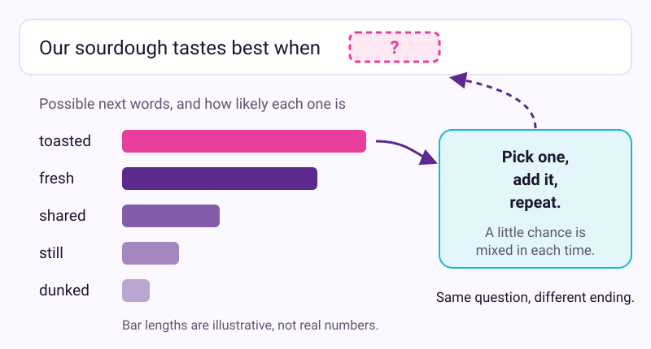
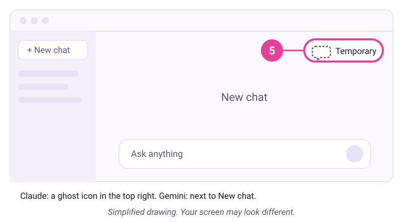

# What is really happening inside the chat box

Checked: November 2026 · Works on: ChatGPT Free, Claude Free or Gemini (free personal Google Account) · Time: 20 min
You need: the free account from lesson 1, signed in. No coding, no paid plan.
Video version: [video script](video-script.md) (video coming later) · Next lesson: [Decide what to hand to AI](../03-decide-what-to-hand-over/README.md)

**Plan note:** all five experiments work on the free plans above. Web search and memory work differently in each app and plan, and they change often. Where a step depends on them, check your app's help page.

## What we'll make

In this tutorial we will make a four-line card that explains, in your own words, how your assistant works. Each line comes from a small experiment you run yourself, so you will have seen it happen.


## Two words to know first

- **Next-word prediction:** the assistant writes its reply a small piece at a time. Each time, it picks a likely next piece based on everything so far. The pieces are called tokens.
- **Context window:** everything the assistant can see right now. That means your messages, its replies and any files you added in this chat. Nothing else.

If you skipped it, start with lesson 1: [Your first useful conversation](../01-first-useful-conversation/README.md).

## Steps

We use Maria's bakery again. She runs it with two staff, so she knows facts the assistant cannot.

1. **In a new chat:** Watch prediction at work. Type this and send it:

   ```text
   Finish this sentence in three different ways: "Our sourdough tastes best when..."
   ```

   Then ask for the same thing again. Many apps show a retry button under the reply, often a circular arrow. If you can't find one, paste the same message into a second new chat.

   

   The assistant does not look up a stored answer. It picks likely next words, with a little chance mixed in. That is why the same question can get different replies.
   > Check: you have at least two different sets of endings. Your answer will be worded differently. That is normal.

2. **In the same chat:** Ask something only you know. This is where made-up details show up.

   ```text
   Who founded Maria's Bakery on Elm Street, and in what year?
   ```

   **Example reply. Yours will be worded differently.**

   ```text
   I don't have reliable information about a bakery by that name on Elm
   Street. Many towns have an Elm Street. If you tell me the town, I can
   help you search, or you can check the bakery's own website.
   ```

   You may get a reply like this one. Or you may get a confident name and year that are invented. Both teach the same thing. When the assistant has no facts, prediction still produces fluent text. Names, numbers, dates, quotes and links are where invented details hide most. Andrej Karpathy describes these models as "a genius polymath and a confused and cognitively challenged grade schooler" at once.

   Now push back with a wrong "fact": type "Are you sure? I think it was 1987." Watch whether it simply agrees with you. Training leaves habits, and agreeing too easily is a common one.
   > Check: you have seen either an honest "I don't know" or a specific detail you know is wrong. Note whether it agreed with your made-up year.

3. **In the same chat:** Find the edge of its knowledge. A model learns from text up to a date, called its **knowledge cutoff**. After that, it only knows what it finds by searching. Type:

   ```text
   When does your training knowledge end? Can you search the web in this chat?
   ```

   Then ask about something from this week, such as "What's the weather forecast for [your town] this weekend?"
   > Check: you can tell which happened. Either the reply shows sources or links, which means it searched, or it says it cannot know. A forecast with no sources is a guess. Whether and when it searches differs by app and plan.

4. **In the same chat:** Watch the context window work. Give it a fact, then a task that needs the fact.

   ```text
   Fact for this chat: Maria's bakery is closed on Mondays.
   Now write a short opening-hours sign for the door, Monday to Sunday.
   ```
   > Check: the sign shows Monday as closed. It knew because the fact is in this chat.

   In very long chats, the assistant can lose track of details from early on. Attention is uneven across a long conversation. Repeat key facts, or start a fresh chat with a short summary.

5. **In a chat with no memory:** Open a temporary chat and ask the same question. This kind of chat does not use what the app remembers about you.
   - ChatGPT: open a new chat and select the **Temporary** button near the top right. Choose **Unpersonalized** before you send anything.
   - Claude: start a new chat outside any project. Click the **ghost icon** in the top right corner.
   - Gemini: next to **New chat**, click **Temporary chat**. This needs a personal Google Account, not a work or school one.

   

   *Simplified drawing. Your screen may look different.*

   Then type: "What day is Maria's bakery closed?"
   > Check: it does not know, or it guesses. The fact lived only in the other chat's context window.

   

   Why use a temporary chat for this test? Some apps have **memory**. They save notes from past chats and add them to a new chat's context. The model still starts blank; the app hands it the notes. Lesson 7 shows how to see and delete them: [Make the AI remember you, or forget you](../07-remember-or-forget/README.md).

6. **On paper or in a notes app:** Write your four-line card. Use your own words and your own results. Add one thing you will do about each line.

   Maria's card:
   1. It predicts likely words. Fluent is not the same as true. *I check every name, number and date.*
   2. Its knowledge stops at a date unless it searches. *For anything recent, I look for sources.*
   3. It only sees this chat. *In long chats, I repeat the key facts.*
   4. A new chat starts blank, except what memory adds. *I give it my facts again, every time.*
   > Check: you have four lines, each with one thing you will do.

## If it went wrong

- You get the same endings every time -> the app may vary less than others -> try a second new chat. Either way, the point stands: it builds text, it doesn't fetch it.
- In step 2 it says "I don't know" at once -> that is the honest answer -> good. Keep checking specifics anyway; it will not always be so careful.
- You can't find the temporary chat option -> you may be in a project, a work account or a phone app -> start a normal new chat. Ask: "Did you use any info from past chats?" Gemini's help pages suggest this question.
- The new chat still knew about Monday -> a memory feature passed the fact along -> that is memory at work, not the model remembering. Lesson 7 covers it.
- It searched in step 3 without being asked -> some apps search automatically -> look for the sources it shows and open one.
- Still stuck? Paste this into the assistant: "I'm on step {n} of a tutorial and I see {x}. What should I check?"

## Stay safe

- A temporary chat is not a vault. It stays out of your history, but the company may keep a copy for a while. ChatGPT says up to 30 days, Claude says 30 days by default, and Gemini says 72 hours.
- Treat fluent, confident replies about names, numbers and dates as unchecked until you have checked them.

## Practice on your own life

Start: a new chat in your usual app. Goal: one new line for your card, tested on your own topic.

Ask about something only you know, such as your street's history or the date your club started. Note whether it invents an answer. Then give it one fact about your week in a chat, and ask for it again in a temporary chat. Write what you saw in one sentence.

## What you made

You now have a card that explains why the first reply in lesson 1 went wrong, built from experiments you ran yourself. It is the mental model the rest of this kit relies on. Next, use it to decide which jobs to hand over: [Decide what to hand to AI](../03-decide-what-to-hand-over/README.md).

---
Sources: [AI capabilities and limitations (Claude Academy)](https://academy.claude.com/courses/ai-capabilities-and-limitations) · [Andrej Karpathy, General Audience videos](https://www.youtube.com/@AndrejKarpathy) · [Karpathy, 2025 LLM Year in Review](https://karpathy.bearblog.dev/year-in-review-2025/) · [Google Skills: Introduction to Generative AI](https://www.skills.google/course_templates/536) · [OpenAI Help: Temporary chat](https://help.openai.com/en/articles/8914046) · [Claude Help: Use incognito chats](https://support.claude.com/en/articles/12260368-use-incognito-chats) · [Gemini Apps Help: Use Gemini Apps](https://support.google.com/gemini/answer/13275745) · [Gemini Apps Privacy Hub](https://support.google.com/gemini/answer/13594961) · [Gemini Apps Help: memory of past chats](https://support.google.com/gemini/answer/16598469) · Screens checked: November 2026 · Plan limits checked: 10 November 2026
