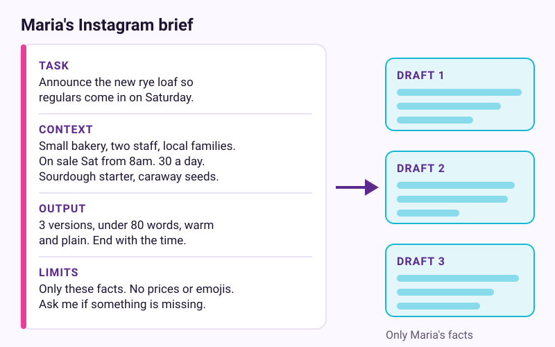
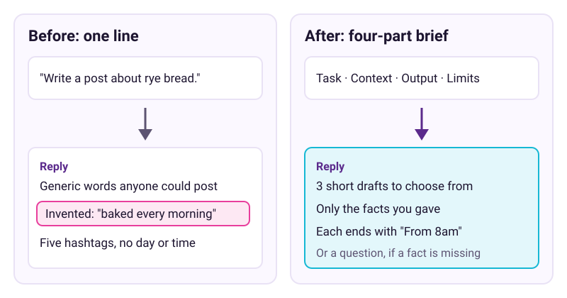
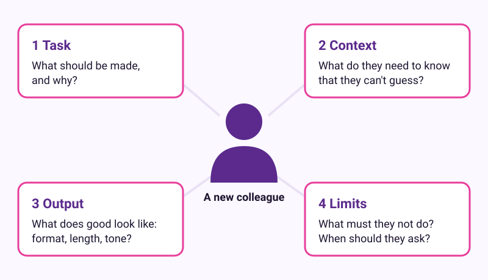

# Brief it like a new colleague

Checked: November 2026 · Works on: any free plan of ChatGPT, Claude or Gemini · Time: 15 min

You need: a free account with one AI assistant, a notes app, and one real writing job from your week

Video version: [video script](video-script.md) (video coming later) · Next lesson: [Check before you trust](../05-check-before-you-trust/README.md)

## What we'll make

In this tutorial we will make a reusable four-part brief. Maria, who runs a small neighbourhood bakery, will use it to get her weekly Instagram post drafted in one go. You will finish with your own brief saved as a template.



## Two words to know first

- **Brief**: a short message that says what to do, why, and what good looks like. Write it for a new colleague who is smart but knows nothing about your work.
- **Context**: everything the assistant can see in this chat. It knows nothing else about you, so the brief must carry what it needs. Lesson 2 explains why a new chat forgets.

## Steps

1. **In a new chat: send the short version first.** Type a one-line request, the way most people do. For Maria, that is `Write an Instagram post about our new rye bread.` Send it and read the reply.

   > Example reply. Yours will be worded differently.
   >
   > "Introducing our delicious new rye bread! Baked fresh every morning with love and the finest ingredients. Pop in today! #bakery #rye #freshbread #local #yum"

   > Check: you should see a generic post. It may also claim things you never said, such as "every morning" or "today".
   > Your answer will be worded differently. That is normal.

2. **In your notes app: write the task in one sentence.** Say what you want made and why. Maria writes this:

   ```
   Task: Write this week's Instagram post to announce our new rye loaf, so our regulars come in on Saturday.
   ```

   > Check: one sentence with a verb, the thing to make, and the reason.

3. **Below the task: add the context a new colleague would need.** List the facts only you know. Keep to what matters for this job, because too much extra detail can make the answer worse.

   ```
   Context: I run a small neighbourhood bakery with two staff. Most followers are locals, many with young children. The new rye loaf goes on sale this Saturday from 8am. We bake 30 a day. It uses our own sourdough starter and has caraway seeds.
   ```

   > Check: every line is true, and none of it is something the assistant could guess.

4. **Below the context: describe the output you want.** Say the format, the length, the tone and how many versions.

   ```
   Output: Give me 3 versions, each under 80 words. Warm and plain, like I talk at the counter. End each with the Saturday start time. Use up to 3 hashtags.
   ```

   > Check: a stranger could read this line and tell whether a draft meets it.

5. **Add limits, then send the whole brief.** Limits say what it must not do. End with a line that invites questions. Paste all four parts into a new chat and send.

   ```
   Limits: Use only the facts above. Don't invent prices, awards or ingredients. No emojis. If something important is missing, ask me before you write.
   ```

   

   > Example reply. Yours will be worded differently.
   >
   > "1. Something new on our shelf this Saturday: a rye loaf made with our own sourdough starter and a little caraway. We only bake 30, so come early. From 8am. #rye #sourdough #neighbourhoodbakery"

   > Check: you should see three short versions, only your facts, and the start time at the end of each. If it asked a question first, answer it.

6. **In the same chat: ask the assistant to improve your brief.** OpenAI, Anthropic and Google all suggest this move. Send this:

   ```
   Before I reuse this brief, how would you improve it? Ask me up to 3 questions about anything unclear.
   ```

   > Example reply. Yours will be worded differently.
   >
   > "1. Should the post speak to regulars only, or also to people walking past? 2. Can people reserve a loaf? 3. Is there anything you never want mentioned, such as prices?"

   > Check: you get questions or suggestions about the brief, not another post. Add the answers you agree with. Ignore the rest.

7. **In your notes app: save the brief as a template.** Name the note "Instagram brief". Replace this week's facts with blanks in square brackets, such as `[this week's item]` and `[day and time]`. Next week, fill the blanks and paste.

   

   > Check: your note has four labelled parts, Task, Context, Output and Limits, with blanks where the weekly facts go.

## If it went wrong

- The drafts invent facts -> the Limits line is missing or buried -> put "Use only the facts above" in Limits and send again.
- The drafts don't sound like you -> it has never seen how you write -> paste one past post you liked and add "Match this tone." Try it with and without the example, because tests disagree on whether examples help.
- You added "think step by step" or "You are a world-class marketer" and nothing improved -> those phrases do little now -> delete them and add a missing fact.
- The reply is long and padded -> the Output line gives no length -> add a word limit and a number of versions.
- Still stuck? Paste this into the assistant: "I'm on step {n} of a tutorial about writing a four-part brief, and I see {x}. What should I check?"

## Stay safe

Leave customers out of your briefs. Write "a regular" instead of a full name, and never paste phone numbers, card numbers or passwords. Read every draft and post it yourself. Never give the assistant the power to post for you. Lesson 6 covers privacy settings.

## Practice on your own life

Start: pick one message you write again and again, such as a reply to a common question or a weekly rota. Goal: a saved four-part brief with blanks, plus one draft you would really send. This time, write all four parts before you send anything. Then ask the assistant to improve the brief.

## What you made

You turned a vague one-liner into a brief a real colleague could act on, and you can reuse it every week. Lesson 5 shows how to check what comes back: [Check before you trust](../05-check-before-you-trust/README.md).

---
Sources: [OpenAI Academy: Prompting fundamentals](https://openai.com/academy/prompting/) · [Anthropic AI Fluency: Effective prompting techniques](https://academy.claude.com/courses/ai-fluency-framework-foundations/effective-prompting-techniques) · [Anthropic AI Fluency: A closer look at Description](https://academy.claude.com/courses/ai-fluency-framework-foundations/a-closer-look-at-description) · [Google Workspace: Prompting guide 101](https://workspace.google.com/resources/ai/writing-effective-prompts) · [Simon Willison: context is king](https://simonwillison.net/2025/Mar/11/using-llms-for-code/) · [Ethan Mollick: which AI to use](https://www.oneusefulthing.org/p/an-opinionated-guide-to-which-ai-b22) · [Forward Future, 30 Oct 2026](http://briefing.forwardfuture.ai/p/does-prompting-still-matter-the-new-rules-for-getting-what-you-want-from-ai) · [Ruben Hassid on examples](https://ruben.substack.com/p/how-to-ask-ai-once) · Screens checked: November 2026 (no app screens in this lesson) · Plan limits checked: 10 November 2026
