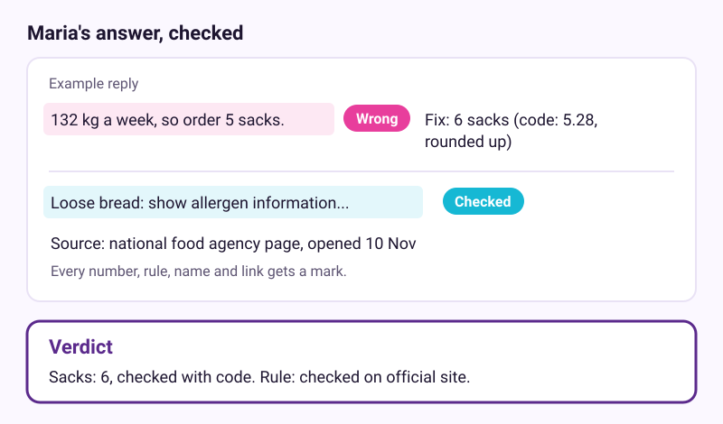
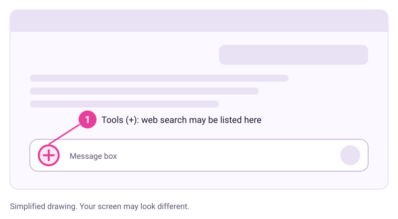

# Check before you trust

Checked: November 2026 · Works on: any free plan of ChatGPT, Claude or Gemini · Time: 20 min

You need: a free account with one AI assistant, and one answer from your week that you want to rely on

Plan notes: web search is on ChatGPT Free and Claude Free, per their help pages. Claude can run code on every plan. For Gemini, and for ChatGPT code, check your plan's help page.

Video version: [video script](video-script.md) (video coming later) · Next lesson: [Keep your private things private](../06-keep-private-things-private/README.md)

## What we'll make

In this tutorial we will make a checked answer. Maria will ask about her Monday flour order and a labelling rule. Every risky claim in the reply will end up marked Checked, Wrong or Open, with a one-line verdict underneath.



## Two words to know first

- **Hallucination**: an answer that sounds sure and specific but is false. It reads exactly like a correct one, so the wording won't warn you.
- **Source**: the page a claim comes from. You can open it and read it yourself. Lesson 2 explains why AI makes things up.

## Steps

1. **In a new chat: ask, then mark the hotspots.** Errors cluster in names, numbers, dates, rules, quotes and links. Maria sends this:

   ```
   I bake 40 loaves a day, 6 days a week. Each loaf uses 0.55 kg of flour. Flour comes in 25 kg sacks. How many sacks should I order each Monday? Also, what allergen information must I show for bread sold loose over the counter?
   ```

   > Example reply. Yours will be worded differently.
   >
   > "You'll use 132 kg of flour a week, so order 5 sacks. For loose bread, you must show a full ingredient label on every loaf, with allergens in bold."

   Copy the reply into a note. Highlight each number, rule and name.

   > Check: you have marked at least two claims, the sack count and the labelling rule. You can't tell from the wording whether either is true. That is the point.

2. **In the same chat: ask it to search the web and link its sources.** Rules change and differ by country, so this needs current pages. Send this, with your country filled in:

   ```
   Search the web for the official rule on allergen information for bread sold loose in [your country]. Link the official pages you used.
   ```

   If your assistant has a tools button, often shown as a plus sign (+) next to the message box, web search may be listed there. In the new Claude experience there is no switch, and Claude searches when needed.

   
   *Simplified drawing. Your screen may look different.*

   > Check: the reply now has links, and at least one goes to an official site, such as a government food agency.

3. **In your browser: open each source and compare.** Click every link. Find the sentence that supports each claim. Mark each claim **Checked**, **Wrong** or **Open**. A link that works but says something different counts as Wrong.

   > Check: every highlighted claim from step 1 has one of the three marks.

4. **Back in the chat: hand the maths to code.** AI predicts text, so it can slip on arithmetic and counting. Send this:

   ```
   Work out the sack count by running code. Show me the code and the result. Round up to whole sacks.
   ```

   Claude runs code on every plan when the code setting is on. The help page names it "Code execution and file creation" in Settings > Capabilities, or "Create and edit files" in the newer layout. If your assistant can't run code, use your phone's calculator.

   > Example reply. Yours will be worded differently.
   >
   > `40 * 6 * 0.55 = 132.0 kg` · `132 / 25 = 5.28` · `Rounded up: 6 sacks`

   > Check: the answer is 6 sacks, not 5. The first reply rounded down, which would leave Maria short by Saturday.

5. **In the same chat: ask it to argue against itself.** Assistants lean towards agreeing with you. Ask for the opposite case. Send this:

   ```
   Now argue against your own answer. What is the strongest reason it could be wrong, and what should I check before I rely on it?
   ```

   > Check: you get at least one specific doubt and one thing to check, not just "I'm confident in this answer".

6. **In your note: match the checking to the stakes, then write a verdict.** A caption needs a quick read. An order that costs money needs the numbers checked. Law, health, money and safety need the official source, and a person who knows if you're unsure.

   

   Maria's verdict: `Sacks: 6, checked with code. Allergen rule: checked on the national food agency site, 10 Nov. Will confirm with my local food-safety office.`

   > Check: your note ends with one verdict line that says what you checked and where.

## If it went wrong

- No links in the reply -> web search didn't run -> start the message with "Search the web" and send again. On Claude Free, searches count towards usage limits that reset every five hours.
- A link is broken or says something else -> the assistant invented or misread it -> mark the claim Wrong and search the official site yourself.
- It won't run code -> your plan or app may not offer it -> use a calculator, and type the sum in yourself.
- "Argue against" just repeats the answer -> ask "List three ways this answer could be wrong."
- Still stuck? Paste this into the assistant: "I'm on step {n} of a tutorial about checking AI answers, and I see {x}. What should I check?"

## Stay safe

For rules on food, health, law or money, the official page or a qualified person has the final say, not the chat. Google's own Gemini help says to double-check responses and not to rely on them for professional advice.

## Practice on your own life

Start: pick a topic you know well, such as your job, your town or a hobby. Ask the assistant to explain one thing about it in 150 words. Goal: every hotspot marked Checked, Wrong or Open, plus one verdict line. Then tell the assistant which sentence was best and which was worst, and why. You are the expert here, so you'll spot what it gets wrong.

## What you made

You turned a smooth answer into one you can stand behind, with every risky claim checked and a verdict written down. Next, keep what you share safe: [Keep your private things private](../06-keep-private-things-private/README.md).

---
Sources: [Anthropic: When properties collide](https://academy.claude.com/courses/ai-capabilities-and-limitations/when-properties-collide) · [Anthropic: AI capabilities and limitations](https://academy.claude.com/courses/ai-capabilities-and-limitations) · [Anthropic AI Fluency: Discernment](https://academy.claude.com/courses/ai-fluency-framework-foundations/a-closer-look-at-discernment) · [DeepLearning.AI: AI Prompting for Everyone, module 1](https://www.deeplearning.ai/courses/ai-prompting-for-everyone) · [Google: Gemini prompt design strategies](https://ai.google.dev/gemini-api/docs/prompting-strategies) · [OpenAI Help: Searching the web with ChatGPT](https://help.openai.com/en/articles/9237897-chatgpt-search-faq) · [Claude Help: Enable and use web search](https://support.claude.com/en/articles/10684626-enable-and-use-web-search) · [Claude Help: Create and edit files with Claude](https://support.claude.com/en/articles/12111783-create-and-edit-files-with-claude) · [Gemini Help: Use Gemini Apps](https://support.google.com/gemini/answer/13275745) · Screens checked: November 2026 · Plan limits checked: 10 November 2026
