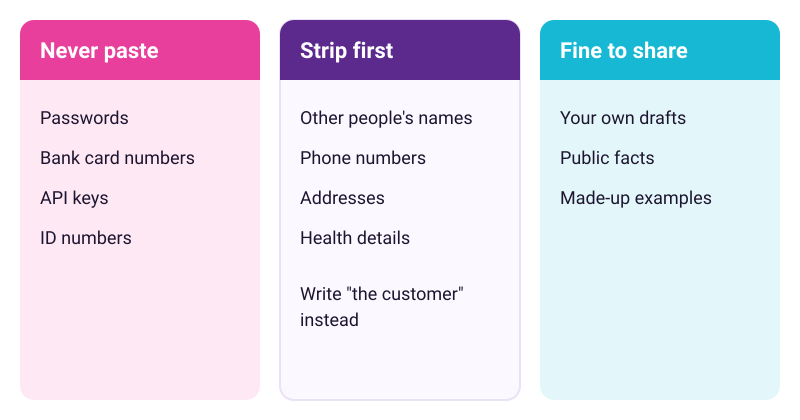
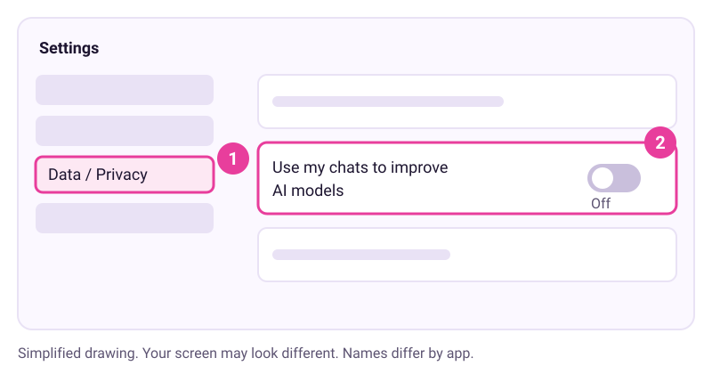
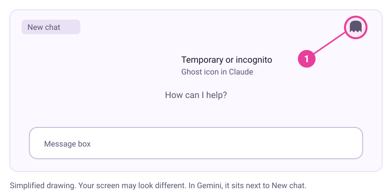

# Keep your private things private

Checked: November 2026 · Works on: any free plan of ChatGPT, Claude or Gemini, on a personal account · Time: 20 min
You need: your assistant open in a web browser and signed in. On a work or school account, your admin controls these settings, so ask them first.
Video version: [video script](video-script.md) (video coming later) · Next lesson: [Make the AI remember you, or forget you](../07-remember-or-forget/README.md)

## What we'll make

In this tutorial we will set up your assistant for privacy. You will choose your training setting, open a temporary chat, check what it remembers, and write a short "never paste" list. Last, you will write a one-line note on how you used AI.


## Two words to know first

- **Model training**: when a company uses your chats to improve its future AI models. ChatGPT, Claude and Gemini each let you switch this off.
- **Temporary chat**: a chat that stays out of your history and memory. ChatGPT and Gemini call it a temporary chat. Claude calls it an incognito chat.

## Steps

1. **On paper or in a note: sort what you share into three piles.** Never paste: passwords, bank card numbers, API keys and ID numbers. Strip first: other people's names, phone numbers, addresses and health details. Fine to share: your own drafts, public facts and made-up examples.

   

   Maria needs help answering a complaint from a customer with a nut allergy. She pastes the complaint with the name, phone number and order number removed. She writes "the customer" instead.

   > Check: your list has at least three items in each pile.

2. **In Settings: choose your training setting.** Follow the steps for your app. Turning it off doesn't delete your chats.
   - **ChatGPT**: open your account menu, then select **Settings** and **Data controls**. Select **Improve the model for everyone**, turn it off, and select **Done**. OpenAI says this is on by default for personal Free, Plus and Pro accounts.
   - **Claude**: select your name, then **Settings** and **Privacy**. Switch off the toggle the help page calls **Help improve our AI models**. Your screen may word it slightly differently. New chats then stay out of future training. Chats already used in training stay in models already trained.
   - **Gemini**: go to gemini.google.com and click **Settings & help**, then **Activity**. Near the top, click **On**, then **Turn off** or **Turn off and delete activity**. This also stops saving new chats to your activity, and some features need it on. Google still keeps chats for up to 72 hours.

   
   *Simplified drawing. Your screen may look different.*

   > Check: the switch shows off. Or you chose to leave it on, and you know why.

3. **In a new chat: open a temporary chat for one sensitive question.**
   - **ChatGPT**: open a new chat and select **Temporary**. Choose **Personalized** or **Unpersonalized** before your first message.
   - **Claude**: start a new chat outside any project. Click the ghost icon in the upper right corner. A black border and an "Incognito chat" label appear.
   - **Gemini**: next to **New chat**, click **Temporary chat**. It needs a personal Google account.

   
   *Simplified drawing. Your screen may look different.*

   All three say temporary chats are not used for training. Temporary does not mean gone at once. ChatGPT may keep a copy for up to 30 days for safety. Claude keeps incognito chats for 30 days by default. Gemini keeps them for 72 hours.

   > Check: you see the temporary label or icon. After you close the chat, it is not in your chat list.

4. **In Settings: check what it remembers about you.** Read the list and delete anything you don't want kept.
   - **ChatGPT**: go to **Settings > Personalization > Memory** and select **Manage**.
   - **Claude**: go to **Settings > Your Claude** and select **Manage** next to **Your memory**. In the older layout, it is **Settings > Memory**.
   - **Gemini**: go to **Settings > Personal Intelligence** and check the **Memory** switch. To remove something it learned, delete the chats that hold it in Gemini Apps Activity.

   Deleting a chat may not delete what was remembered from it. OpenAI says this about saved memories, and Claude's current help page says the same. Delete the memory itself. Lesson 7 goes deeper.

   > Check: you have read your memory list. You deleted at least one item, or you confirmed nothing there should go.

5. **In any chat: think before you press thumbs up or thumbs down.** Feedback can send the whole conversation to the company, even after you opt out of training.
   - **ChatGPT**: the whole conversation may be used for training.
   - **Claude**: the conversation is stored for up to 5 years, separated from your account ID.
   - **Gemini**: with Keep Activity off, feedback includes your last 24 hours of chats.

   > Check: you can say in one sentence why you'd skip feedback on a private chat.

6. **At the end of a piece of work: write your one-line AI note.** Say what the AI did, what you checked, and what you kept out. Maria adds this to the bottom of her new price list draft:

   ```
   Drafted with help from an AI assistant. I checked every fact and price myself. No customer details were shared.
   ```

   > Check: your note names the AI's role, what you checked, and what you didn't share.

## If it went wrong

- You can't find the setting -> menus move often -> search the app's help centre for "data controls", "privacy" or "Keep Activity", and follow today's steps.
- The switch is greyed out -> a work, school or family account controls it -> ask the account owner.
- No temporary chat button in Claude -> you are inside a project -> leave the project and start a new chat.
- Gemini features stopped working after Keep Activity went off -> some features need it on -> decide which matters more, and use temporary chats for sensitive questions.
- Still stuck? Paste this into the assistant: "I'm on step {n} of a tutorial about privacy settings in {app}, and I see {x}. What should I check?"

## Stay safe

- Never paste passwords, card numbers, keys or ID numbers into any chat, even a temporary one.
- Google says human reviewers read some Gemini chats. With Keep Activity on, don't enter anything you wouldn't want a reviewer to see.
- Connected apps need care too. On ChatGPT Free, Plus, Go and Pro, data read from connected apps may be used for training if "Improve the model for everyone" is on. Lesson 8 covers connecting apps safely.

## Practice on your own life

Start: open the assistant you use most. Goal: all five rows of the checklist done for that app, and your own one-line AI note. Then pick one real task with a private detail in it. Strip the detail, ask your question in a temporary chat, and check that the chat is gone afterwards.

## What you made

You now decide what your assistant learns from you, and you have a habit of owning your AI work in one honest line. Next, use memory on purpose: [Make the AI remember you, or forget you](../07-remember-or-forget/README.md).

---
Sources: ChatGPT: [Data controls](https://help.openai.com/en/articles/7730893-data-controls-in-chatgpt), [Temporary chat](https://help.openai.com/en/articles/8914046), [How your data is used](https://help.openai.com/en/articles/5722486-how-your-data-is-used-to-impr), [Connected apps](https://help.openai.com/en/articles/11487775), [Memory](https://help.openai.com/en/articles/8590148-memory-in-chatgpt) · Claude: [Model improvement settings](https://privacy.claude.com/en/articles/12109829-how-do-i-change-my-model-improvement-privacy-settings), [Is my data used for model training?](https://privacy.claude.com/en/articles/10023580-is-my-data-used-for-model-training), [How long do you store my data?](https://privacy.claude.com/en/articles/10023548-how-long-do-you-store-my-data), [Incognito chats](https://support.claude.com/en/articles/12260368-use-incognito-chats), [Chat search and memory](https://support.claude.com/en/articles/11817273-use-claude-s-chat-search-and-memory-to-build-on-previous-context) · Gemini: [Privacy Hub](https://support.google.com/gemini/answer/13594961?hl=en), [Manage your activity](https://support.google.com/gemini/answer/13278892?hl=en), [Use Gemini Apps (temporary chat)](https://support.google.com/gemini/answer/13275745), [Memory](https://support.google.com/gemini/answer/16598469?hl=En&ref_topic=16597779) · Courses: [Anthropic AI Fluency: Diligence](https://academy.claude.com/courses/ai-fluency-framework-foundations/a-closer-look-at-diligence), [Microsoft Learn: Build foundational generative AI skills](https://learn.microsoft.com/en-us/training/paths/explore-microsoft-365-copilot-business-chat) · Screens checked: November 2026 · Plan limits and settings checked: 10 November 2026
