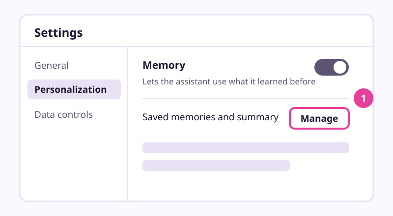

# Make the AI remember you, or forget you

Checked: November 2026 · Works on: ChatGPT Free (main path), Claude Free, Gemini with a personal Google Account · Time: 20 min

You need: a free ChatGPT account, and five minutes of facts about your work that you are happy to share.

Plan notes: memory is on all three free plans, but the controls differ. In Gemini, memory needs you to be 18 or over, a personal Google Account and Keep Activity on. Gemini's memory summary page is US-only, English-only and needs an active Google AI plan. Claude's search of past chats needs a paid plan.

Video version: [video script](video-script.md) (video coming later) · Next lesson: [Connect your email and calendar safely](../08-connect-email-calendar-safely/README.md)

## What we'll make

In this tutorial we will make an assistant that remembers the right things about Maria's bakery and nothing else. We will check what it already knows, delete one thing it should not keep, and give the bakery its own project with its own memory.

## Two words to know first

- **Memory**: notes the assistant keeps about you between chats. A new chat starts empty unless memory fills it in (see lesson 2, *What is really happening inside the chat box*).
- **Project**: a folder for chats, files and standing instructions about one topic. A project can have its own memory that stays inside it.

## Steps

1. **Settings: look at what it already knows.** In ChatGPT, open **Settings**, select **Personalization**, then **Memory**. Read the list or summary you see there.
   
   *Simplified drawing. Your screen may look different.*
   > Check: you should see either a list of saved memories, a short memory summary, or a switch showing memory is off.
   > The controls vary by plan and region. OpenAI says a setting may simply not be on your account yet.

2. **Memory list: delete what it should not keep.** Maria once pasted a customer's complaint, phone number included. Find that item and delete it. Then delete the chat where she first shared it.
   > Check: the item is gone from the list or summary.
   > Do both. A saved memory lives apart from the chat, so deleting only the chat leaves the memory. Deleting only the memory leaves the words in the old chat. OpenAI may keep logs of deleted memories for up to 30 days.

3. **New chat: tell it one fact on purpose.** Type: *"Remember this: my bakery is closed on Mondays, I order flour and butter every Monday, and I like replies that are warm and short."* Then open **Settings > Personalization > Memory** again.
   > Check: the three facts now appear in your memory list or summary.

   > Example reply. Yours will be worded differently.
   > "Got it. I'll remember that your bakery is closed on Mondays, that you order flour and butter every Monday, and that you prefer warm, short replies."

4. **Sidebar: make a bakery project with its own memory.** Create a new project called *Bakery*. Open the project's more options menu (three dots), select **Project settings**, then under **Memory** select **Project-only memory**, and **Save**.
   > Check: the project settings show Project-only memory.
   > OpenAI says the change can take a few hours. With project-only memory, chats in the project do not use your other saved memories, and chats outside cannot see the project.

5. **Bakery project: give it a standing note you own.** Write a short plain-text note called *about-bakery*: opening hours, what you sell, how you write, who you order from. Leave out phone numbers and staff details. Paste it into the project's instructions, or add it as a file (Free allows 5 files per project).
   > Check: a new chat inside the project can answer "What days are we closed?" without you saying it again.
   > Keep the note on your own computer too. It is the only memory you can fully read, edit and carry to another app. Coding tools use the same idea with plain files called CLAUDE.md or AGENTS.md.

6. **Bakery project: ask what it used.** In a project chat, ask: *"What do you know about my bakery, and where did each fact come from?"* Under a reply, look for **Sources**, which shows the memory or chat it drew on.
   > Check: the answer lists your facts and points to your note or project chats, not to chats outside the project.

7. **New chat: use a temporary chat for one-off private questions.** Before you start, choose **Unpersonalized**. Temporary chats do not create or update memories. If you can't find the temporary chat switch, see OpenAI's [Temporary chat](https://help.openai.com/articles/8914046) page.
   > Check: after the chat, your memory list has not changed.
   > If you save a temporary chat, it becomes a normal chat and can feed memory again.

### Using Claude or Gemini instead

| Step | Claude (Free) | Gemini (personal account, 18+) |
|---|---|---|
| See what it knows | **Settings > Your Claude**, then **Manage** next to **Your memory**. Each item is a topic you can edit or delete. Older layouts use **Settings > Memory**. | **Settings > Personal Intelligence > Memory** turns it on or off. The **Memory summary** page is US-only with a Google AI plan. Anyone can ask "Did you use any info from past chats?" |
| Delete | Delete the topic. Deleting a chat does not remove memory made from it. | Delete the chats that hold the info in **Gemini Apps Activity**. Google says there may be a short delay. |
| Project memory | Each project has its own memory. To keep it fully separate, turn off **Use account memory** under **Memory** on the project page. Free accounts get up to five projects. | No project memory on the pages we checked. Turn off **Personal Intelligence** for one chat under **Tools**. |
| No memory for one chat | Turn off **Memory** in the **+** menu before your first message, or use an incognito chat (the ghost icon, top right, outside projects). | Use a temporary chat. |

The help pages disagree with older guides here. Claude's memory page now lists *topics* with an edit icon, while older guides describe one summary with a pencil icon. If yours differs, follow the linked help page.

## If it went wrong

- You see no Memory section -> your plan, region or app version doesn't have it yet -> update the app, or check OpenAI's [Memory in ChatGPT](https://help.openai.com/en/articles/8590148-memory-in-chatgpt) page.
- A deleted fact comes back -> it is still in an old chat, a file or a connected app -> delete it there too.
- The project still knows your personal memories -> it is on Default memory, or the change hasn't applied yet -> recheck **Project settings** after a few hours.
- Gemini says Memory isn't available -> Keep Activity is off, or it's a work account -> turn Keep Activity on, or use a personal account.
- Still stuck? Paste this into the assistant: "I'm on step {n} of a tutorial about memory settings and I see {x}. What should I check?"

## Stay safe

Never ask an assistant to remember passwords, card numbers, or other people's private details. Check your memory list once a month, and delete anything you would not write on a sticky note at work.

## Practice on your own life

Start: open your memory settings in your own assistant. Goal: one thing deleted, three useful facts saved on purpose, and one project with its own memory for a part of your life. Pick a hobby, a club you help run, or a home project. Write its standing note yourself, then ask the project what it knows and where it learned it.

## What you made

You now decide what your assistant knows, and you can see and remove it. That control matters in the next lesson, where we connect your email and calendar: [Connect your email and calendar safely](../08-connect-email-calendar-safely/README.md).

---
Sources: [OpenAI: Memory in ChatGPT](https://help.openai.com/en/articles/8590148-memory-in-chatgpt) · [OpenAI: Projects in ChatGPT](https://help.openai.com/en/articles/10169521-using-projects-in-chatgpt) · [Claude: chat search and memory](https://support.claude.com/en/articles/11817273-use-claude-s-chat-search-and-memory-to-build-on-previous-context) · [Claude: projects](https://support.claude.com/en/articles/9519177-how-can-i-create-and-manage-projects) · [Gemini: memory of past chats](https://support.google.com/gemini/answer/16598469?hl=en) · [Gemini: memory summary](https://support.google.com/gemini/answer/18617127?hl=en) · [Claude Code: CLAUDE.md memory files](https://code.claude.com/docs/en/memory) · Screens checked: November 2026 · Plan limits checked: 10 November 2026
