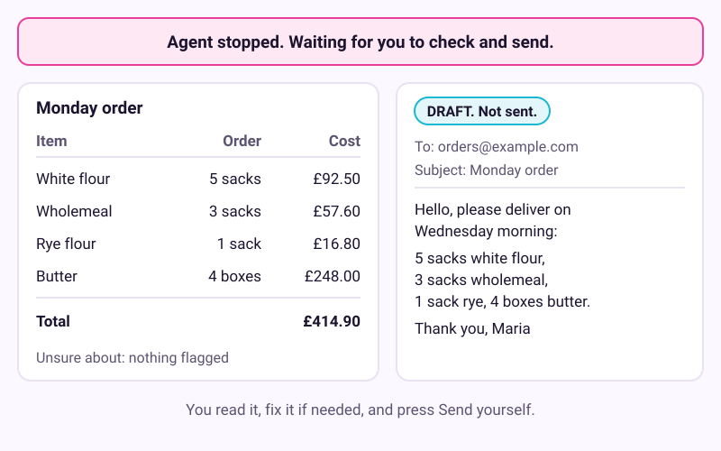
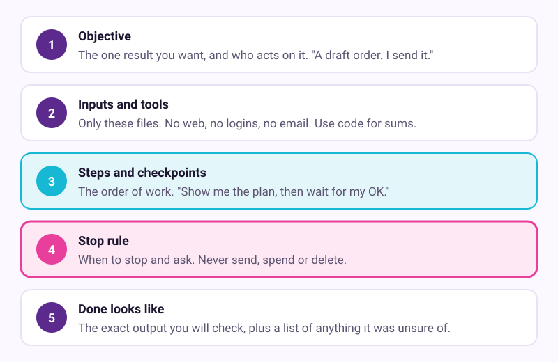
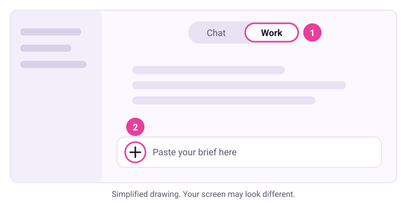
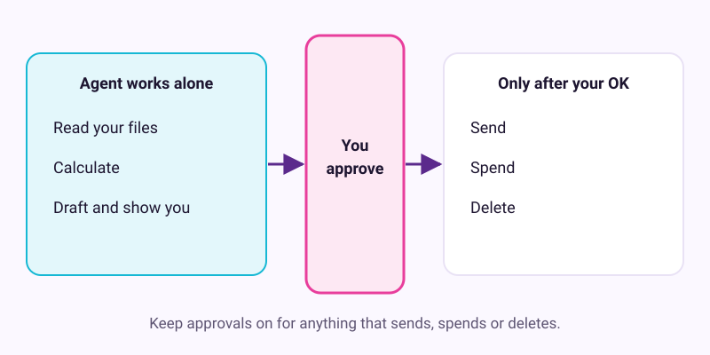

# Hand a multi-step job to an agent

Checked: November 2026 · Works on: ChatGPT Work in the ChatGPT desktop app (all plans, including Free, with limited use) · ChatGPT Work on web and mobile (Plus and up) · Claude Cowork (paid plans) · Time: 25 min
You need: one of the agents above, a job you do every week, and the two sample files below (or your own)
Video version: [video script](video-script.md) (video coming later) · Next lesson: [11. Write your first skill](../11-write-your-first-skill/README.md)

Plan check: this lesson needs an agent, not a plain chat. The free route is the ChatGPT desktop app on Windows or Mac. OpenAI says Work is on every plan there, but Free use is limited. On the web and phone apps, Work needs Plus or higher. Claude Cowork needs a paid Claude plan. Plans change often, so check your plan's help page before you start.

## What we'll make

In this tutorial we will hand Maria's Monday flour and butter order to an agent. The agent reads her stock sheet and price list, works out what to order, shows its working, and drafts the supplier email. Then it stops. Maria checks it and presses Send herself.



## Two words to know first

- **Agent**: an AI that works through several steps on its own, using tools such as files, code or a browser, before it reports back. A chat answers; an agent does a job.
- **Checkpoint**: a point where the agent must stop, show you what it has, and wait for your OK. You choose where they go.

Tutorial 3 covers how to decide what to hand over. This lesson is about how to hand it over well.

## Steps

1. **On paper: pick a job that suits an agent.** Ask three questions about it. Does it have several steps? Can you check the result in two minutes? Does a wrong draft cost nothing? Maria's Monday order passes all three. A wrong order costs money, so the agent only drafts it.

   > Check: you have one job, and you answered yes three times. If any answer is no, pick a smaller job.

2. **On your computer: put the inputs in one folder.** Make a folder called `monday-order`. Save these two sample files in it as plain text. Or use your own, with the same columns.

   `stock-and-usage.csv`
   ```text
   item,unit,in_stock,used_wk1,used_wk2,used_wk3,used_wk4,last_order
   strong white flour,25 kg sack,3,6,6,7,6,4
   wholemeal flour,25 kg sack,1,2,2,2,3,2
   rye flour,16 kg sack,1,1,1,1,1,1
   butter,10 kg box,2,4,5,4,4,3
   ```

   `prices.csv`
   ```text
   item,unit,price
   strong white flour,25 kg sack,18.50
   wholemeal flour,25 kg sack,19.20
   rye flour,16 kg sack,16.80
   butter,10 kg box,62.00
   ```

   > Check: the folder holds two files and nothing private. No account numbers, passwords or card details go in.

3. **In a notes app: write the five-part brief.** Tell the agent what you would tell a new colleague. Give it the goal, the tools, the stops and the finish line. Copy Maria's brief and change it to fit your job.

   

   ```text
   OBJECTIVE
   Prepare this Monday's flour and butter order for Maria's Bakery, as a table
   and a draft email to our supplier. I will send the email myself.

   INPUTS AND TOOLS
   Use only the two attached files. Do not browse the web, log in anywhere or
   use connected apps. Use code for every calculation.

   STEPS AND CHECKPOINTS
   1. Read both files. Tell me your plan in 3 to 5 lines. Wait for my OK.
   2. For each item: weekly use = average of the 4 weeks, rounded up.
      Order = weekly use + 1 spare - in stock. Never below 0.
   3. Show a table: item, in stock, weekly use, order, unit price, line cost,
      and the total. Wait for my OK.
   4. Draft a short, polite email to Millbrook Supplies (orders@example.com)
      asking for delivery on Wednesday morning.

   STOP RULE
   Stop and ask me if an item has no price, if any order is more than double
   last_order, or if the total is over £500. Never send, order, pay or delete
   anything.

   DONE LOOKS LIKE
   The table, the email marked DRAFT, and one line listing anything you were
   unsure about.
   ```

   > Check: your brief has all five headings, at least one "wait for my OK", and a line that starts "Never".

4. **In the agent: start the job.** In the ChatGPT desktop app, select **Work** instead of Chat. In Claude, open **Cowork**. Use the plus or attach button to add both files. Paste your brief and send it. Leave the approval settings as they are, and do not connect your email for this job.

   

   *Simplified drawing. Your screen may look different.* Some agents also have a Plan mode that writes a plan and waits for your approval. You can use it, but your brief already asks for a plan.

   > Check: the agent starts working and shows its progress. It does not jump straight to a finished email.

5. **At checkpoint 1: approve the plan.** Read the plan. It should repeat your rule in its own words and say it will wait after the table. If something is off, say so now, for example "Use the last 4 weeks only." Then reply "OK, go ahead."

   > Example reply. Yours will be worded differently.
   > "Plan: 1. Read stock-and-usage.csv and prices.csv. 2. Use Python to average weekly use per item and round up. 3. Order = weekly use + 1 spare minus stock. 4. Show the table and wait. 5. Draft the email after your OK."

   > Check: the plan has 3 to 5 steps, mentions code for the sums, and ends with a stop. The agent is waiting for you.

6. **At checkpoint 2: check the table like an editor.** Work out one line yourself. White flour: the average of 6, 6, 7 and 6 is 6.25, which rounds up to 7. Add 1 spare to get 8, then take away 3 in stock: order 5. With the sample files, the total should be £414.90. Compare each order with last week's. Then reply "OK, draft the email."

   > Check: your line matches the agent's, the total matches, and nothing triggered the stop rule. If a number differs, ask "Show me how you calculated {item}."

7. **In your email: send it yourself, then improve the brief.** Copy the draft into your own email app. Read it once more and press Send. Then write down one thing you would add to the brief next time, such as "Ask for delivery before 9:00." Save the brief as `monday-order-brief.txt`. Tutorial 11 turns it into a skill.

   > Check: the email went from your account, by your hand. Your saved brief now has one more rule than before.

## If it went wrong

- You cannot find Work -> your app is old, or your plan lacks it on that device -> update the app, or check your plan's help page.
- The agent skipped a checkpoint -> the brief did not say "wait" clearly -> stop the task and add "Stop and wait for my reply" after that step.
- A number looks wrong -> agents can slip on arithmetic -> ask it to show the code it ran, and check one line by hand.
- The agent asks to log in to a supplier site or your email -> it went beyond the brief -> decline, and repeat "Use only the attached files."
- You hit a usage limit -> agent jobs use more of your allowance than chats -> wait for the limit to reset, or try a smaller job.
- Still stuck? Paste this into the assistant: "I'm on step {n} of a tutorial about giving an agent a brief with checkpoints, and I see {x}. What should I check?"

## Stay safe



- Keep approvals on for anything that sends, spends or deletes. Ethan Mollick's advice is to leave everything on ask-first until you trust the system. In Cowork, do not choose "Skip all approvals"; Anthropic warns that then "nothing checks its actions".
- Draft, don't send. The agent prepares; you press the button.
- Give the agent only what this job needs. This brief uses two files and no email, web or logins. That way, a sneaky instruction hidden in a web page or email has nothing to reach.
- Never put passwords, card numbers or account logins in a brief or a file you attach.

## Practice on your own life

Start: one job you do every week that has several steps, such as planning the week's meals and shopping list. Goal: an agent produces a draft you check in two minutes, and you act on it yourself. Write the five-part brief without copying Maria's. Put in at least two checkpoints and a stop rule that starts "Never".

## What you made

You briefed an agent like a new colleague, made it stop twice, checked its numbers and kept the last click for yourself. That habit is what makes agents safe to use. Next: [11. Write your first skill](../11-write-your-first-skill/README.md) turns this brief into something you can reuse every Monday.

---
Sources: [OpenAI Academy: Workspace agents](https://openai.com/academy/workspace-agents/) · [OpenAI Academy: Agents and Workflows](https://academy.openai.com/public/courses/agents-and-workflows-bieml) · [OpenAI Help: ChatGPT Work and Codex](https://help.openai.com/en/articles/20001275-chatgpt-work-and-codex) · [ChatGPT Work page](https://chatgpt.com/work/) · [OpenAI: ChatGPT Work launch, 9 July 2026](https://openai.com/index/chatgpt-for-your-most-ambitious-work) · [OpenAI Help: ChatGPT agent (retired)](https://help.openai.com/en/articles/11752874-chatgpt-agent) · [Claude Help: Get started with Cowork](https://support.claude.com/en/articles/13345190-get-started-with-claude-cowork) · [Claude Help: Use Cowork safely](https://support.claude.com/en/articles/13364135-use-claude-cowork-safely) · [Mollick: which AI to use](https://www.oneusefulthing.org/p/an-opinionated-guide-to-which-ai-b22) · [Willison: the lethal trifecta](https://simonwillison.net/2025/Jun/16/the-lethal-trifecta) · Screens checked: November 2026 (drawings, not screenshots of vendor apps) · Plan limits checked: 10 November 2026
