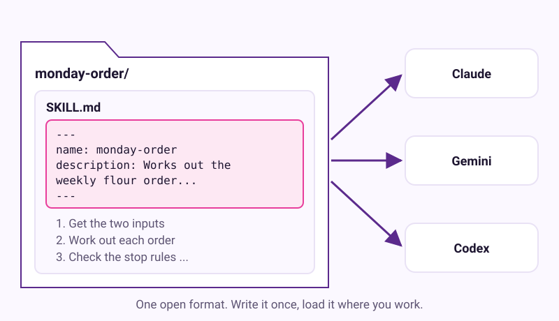
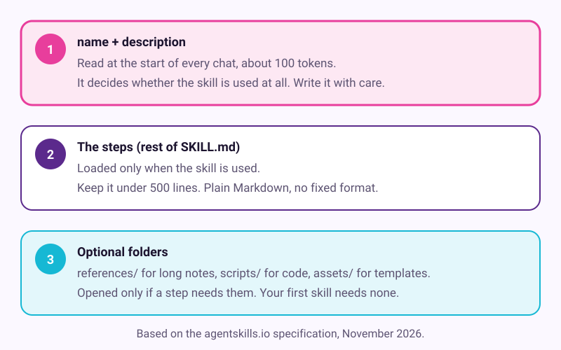
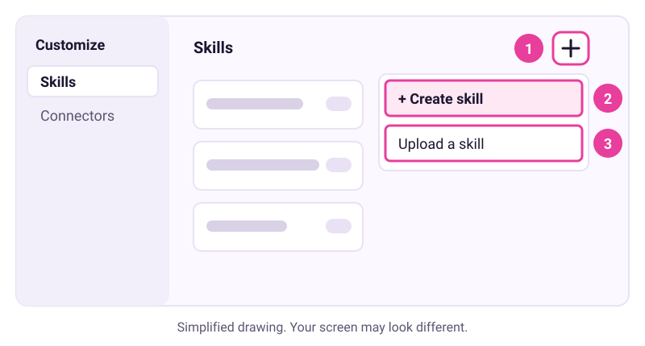

# Write your first skill

Checked: November 2026 · Works on: Claude (Free and paid, with code execution on), Gemini (18+), Codex · Time: 30 min

You need: a job you have done at least twice, a plain text editor, and an account with one of the apps above

Video version: [video script](video-script.md) (video coming later) · Next lesson: [12. Build and publish a one-page site](../12-publish-a-one-page-app/README.md)

Plan check: Claude's help centre says skills work on Free, Pro, Max, Team and Enterprise. Anthropic's developer docs leave Free out for custom uploads, so check your plan's help page if upload fails. Gemini skills need you to be 18 or over. Codex is limited on ChatGPT Free, and OpenAI does not say clearly which Codex apps Free covers.

## What we'll make

In this tutorial we will turn Maria's Monday order from tutorial 10 into a skill. It is one folder with one file, `SKILL.md`. After that, Maria types "Monday order" and the assistant follows the same steps and stops every week, without her pasting the brief again.



The finished file is here: [example/monday-order/SKILL.md](example/monday-order/SKILL.md).

## Two words to know first

- **Skill**: a folder of instructions an assistant loads when a job calls for it. It is like a recipe card the assistant takes off the shelf.
- **Description**: the one or two sentences at the top that say what the skill does and when to use it. The assistant reads only this until it decides to use the skill.



The format is an open standard, published at agentskills.io. Anthropic first released it in December 2025. Claude, Codex and Gemini all read it, so one folder works in all three.

This lesson follows the five stages of the kit's own [skill-builder](https://github.com/Szykla/free-ai-kit/blob/main/skills/skill-builder/SKILL.md) skill. They are: capture the job, split fixed from varying, place approval steps, write it, and test it. Read that file now. It is itself a skill, and it is only 40 lines long.

## Steps

1. **In your notes: capture the job.** Pick a job you have done twice, ideally one you just did with an AI. Your corrections from last time are the rules. Maria has her saved brief from tutorial 10, plus the rule she added: "Ask for delivery before 9:00."

   > Check: you have the job written down, with at least one correction you made along the way.

2. **In your notes: split what stays fixed from what changes.** Make three short lists.

   ```text
   FIXED     the order of steps, the rounding rule, the stop rules,
             the supplier, the table format, "draft only"
   VARIES    this week's stock counts, prices, dates
   JUDGMENT  whether to send the email -> this becomes an approval step
   ```

   Never hard-code this week's numbers. The skill must work next Monday too.

   > Check: every number in your FIXED list is a rule ("one spare"), not a value ("3 sacks").

3. **In your notes: write the description first.** It decides whether the skill ever runs. Say what it does and when to use it, with the words you really type. The limit is 1,024 characters; aim for two sentences.

   ```text
   Poor:  Helps with orders.

   Good:  Works out Maria's Bakery's weekly flour and butter order from the
          stock sheet and price list, then drafts the supplier email for Maria
          to send herself. Use when Maria says "Monday order", "flour order",
          "butter order", or asks what to order from Millbrook Supplies.
   ```

   > Check: your description names the job, the inputs, the result, and two or more phrases you would actually type.

4. **In a text editor: write `SKILL.md` in a folder with the same name.** Make a folder called `monday-order`. Inside it, save a plain text file called exactly `SKILL.md`. Start with the front matter between two `---` lines, then the steps. Here is the top of Maria's file. The whole file is in [example/monday-order/SKILL.md](example/monday-order/SKILL.md).

   ```markdown
   ---
   name: monday-order
   description: Works out Maria's Bakery's weekly flour and butter order from the stock sheet and price list, then drafts the supplier email for Maria to send herself. Use when Maria says "Monday order", "flour order", "butter order", or asks what to order from Millbrook Supplies.
   ---

   # Monday order

   ## 1. Get the two inputs
   Ask for this week's `stock-and-usage.csv` and `prices.csv` if they are not attached.
   Why: the order is only as good as this week's count.
   If one is missing, stop and say which one. Do not use last week's numbers.
   ...
   ## 4. Show the table and wait
   Ask: "Here are 4 lines, total £{total}. Draft the email to Millbrook Supplies?"
   ...
   Never send, order, pay or delete anything. Maria sends the email herself.
   Never invent a number. If a value is missing, say so.
   ```

   Give each step a short "why". Add an approval step before anything that sends, spends, publishes or deletes. Make it say exactly what will happen, not "Ready to proceed?".

   > Check: the file has a front matter block, numbered steps, at least one approval step, and the line "Never invent a number."

5. **In your file: check it against the rules.** Go down this list before you upload.

   - `name` uses only lowercase letters, numbers and single hyphens, up to 64 characters. It must not start or end with a hyphen.
   - `name` matches the folder name exactly: `monday-order` and `monday-order/`.
   - `description` says what and when, in 1,024 characters or fewer.
   - Only spec fields are in the front matter: `name`, `description`, and optionally `license`, `compatibility` or `metadata`. Claude's docs warn that an extra field makes a claude.ai upload fail.
   - The file is under 500 lines. Longer detail goes in a `references/` folder.

   If you are comfortable with a terminal, the spec offers a checker: `skills-ref validate ./monday-order`.

   > Check: every line on the list is true for your file.

6. **In your app: load the skill.** Pick the app you use.

   - **Claude:** in **Settings > Capabilities**, turn on **Code execution and file creation** (newer layouts call it **Create and edit files**). Compress the `monday-order` folder into a ZIP file. Go to **Customize > Skills**. Select the **+** button, then **+ Create skill**, then **Upload a skill**. Upload the ZIP and make sure the skill is toggled on.
   - **Gemini:** at gemini.google.com, select **Customize** in the sidebar (under **More** if you don't see it). At the top, select **Skills**. Choose the option to upload a file or folder, and pick your `monday-order` folder.
   - **Codex:** copy the folder to `~/.agents/skills/monday-order/` in your home folder. Codex notices new skills by itself. If it does not appear, restart Codex.

   

   *Simplified drawing. Your screen may look different.* It follows Claude's steps; Gemini's page has its own wording.

   > Check: your skill appears in the app's skills list, with your description under its name.

7. **In a new chat: test it on a known case.** Attach last week's two files, the ones from tutorial 10. Type "Can you do the Monday order?" Compare the result with last week's. With the sample files, the total should be £414.90. The skill should stop before drafting. Then test the edges. Type "Write an Instagram post about croissants". The skill should not run.

   > Example reply. Yours will be worded differently.
   > "Using the monday-order skill. Here are 4 lines, total £414.90. Draft the email to Millbrook Supplies?"

   > Check: the skill runs for your order phrase and gives last week's total. It waits at the approval step and stays quiet for an unrelated request.

## If it went wrong

- Upload fails -> the folder name and `name` differ, `SKILL.md` is misnamed, or there is an extra field -> fix it and zip again.
- No Skills section in Claude -> code execution is off -> turn it on in **Settings > Capabilities**, then look in **Customize > Skills** again.
- The skill never runs -> the description is too vague -> add the exact phrases you type, then upload again.
- The skill runs for the wrong jobs -> the description is too broad -> say when not to use it, for example "Not for cake orders."
- The numbers differ from last week -> a rule is missing or unclear -> fix that step, upload again and rerun the same files.
- Still stuck? Paste this into the assistant: "I'm on step {n} of a tutorial about writing a SKILL.md file and I see {x}. What should I check?"

## Stay safe

- Put an approval step before anything that sends, spends, publishes or deletes. A skill runs the same way every time, so a missing stop repeats every week.
- Install skills only from people you trust, and read every file first. Anthropic's docs say to use skills "only from trusted sources" and to audit thoroughly any skill from an unknown source. A skill can hide instructions you would never agree to.
- Never put passwords, keys or card numbers in a skill. Anyone you share it with can read them.

## Practice on your own life

Start: a job you have done with an AI at least twice, such as a weekly family meal plan. Goal: a working skill you load in one app and test against last time's result. This time, let the kit's skill-builder lead. Upload [skill-builder](https://github.com/Szykla/free-ai-kit/blob/main/skills/skill-builder/SKILL.md) the same way as step 6, then say "Turn this job into a skill" and answer its questions. Check its draft against the list in step 5 before you upload it.

## What you made

You turned a weekly job into a small, readable file that any of three assistants can follow, with your own stops built in. Next: [12. Build and publish a one-page site](../12-publish-a-one-page-app/README.md) builds Maria's bakery website.

---
Sources: [agentskills.io specification](https://agentskills.io/specification) · [Claude Help: Use skills in Claude](https://support.claude.com/en/articles/12512180-using-skills-in-claude) · [Claude Platform Docs: Agent Skills overview](https://platform.claude.com/docs/en/agents-and-tools/agent-skills/overview) · [Claude Code Docs: skills](https://code.claude.com/docs/en/skills) · [Gemini Help: Create and manage skills](https://support.google.com/gemini/answer/17094296?hl=en) · [OpenAI Developers: Codex skills](https://developers.openai.com/codex/skills) · [Claude blog, 18 December 2025](https://claude.com/blog/organization-skills-and-directory) · [DeepLearning.AI: Agent Skills with Anthropic](https://www.deeplearning.ai/courses/agent-skills-with-anthropic) (free to enrol, for more depth) · Screens checked: November 2026 (drawings, not screenshots of vendor apps) · Plan limits checked: 10 November 2026
