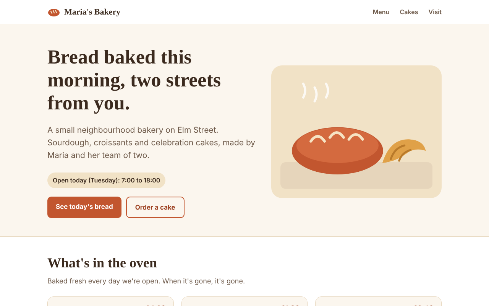
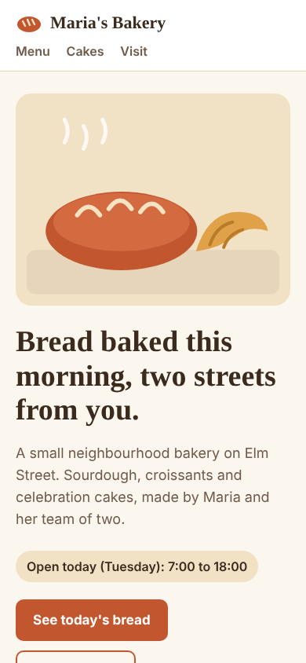
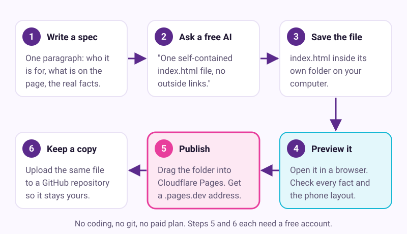
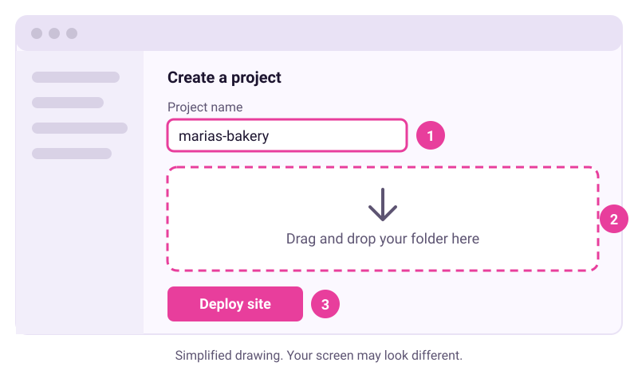
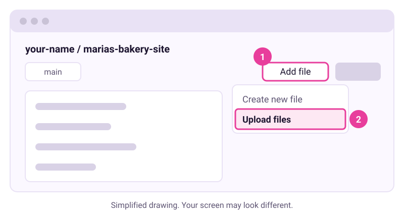

# Build and publish a one-page site without coding

Checked: November 2026 · Works on: any free chat AI (Claude Free, ChatGPT Free or Google AI Studio) plus free Cloudflare and GitHub accounts · Time: 40 min

You need: a free chat AI account, a free Cloudflare account, a free GitHub account, and the real facts for your page (hours, prices, contact details)

Video version: [video script](video-script.md) (video coming later) · Next lesson: [13. Add logins and data without leaking them](../13-logins-and-data-without-leaks/README.md)

Plan check: nothing in this lesson needs a paid plan. You never need a credit card. If a site asks for one, stop and check you are on the free route described here.

## What we'll make

In this tutorial we will make Maria's bakery website. It is one page with today's opening hours, the bread menu, cake orders and directions. It will be live on the internet at an address ending in `.pages.dev`, with a backup copy on GitHub.





You can open the finished file yourself: [example/index.html](example/index.html). It is one file with no outside links, images or fonts. It makes no requests to any other site.

## Two words to know first

- **index.html**: the file a web host shows first when someone visits your address. A whole simple site can live in this one file.
- **Static site**: a site made only of files that look the same for every visitor. It has no logins and stores no data, so there is little that can leak.



## Steps

1. **In a notes app: write a one-paragraph spec.** Say who the page is for, what goes on it, and every real fact. Here is Maria's:

   ```text
   A one-page website for Maria's Bakery, a small neighbourhood bakery at
   14 Elm Street, next to the library. Visitors are local people on their phones.
   Show: today's opening hours (Mon closed, Tue-Fri 7:00-18:00, Sat 7:00-15:00,
   Sun 8:00-13:00), a menu of six items with prices (country sourdough £4.20,
   butter croissant £1.90, cinnamon bun £2.40, seeded rye £4.50, fruit scone £1.80,
   bread of the week £4.00), how to order a celebration cake (three days' notice,
   6 inch from £28, 8 inch from £40, pay on collection), an allergy note, and
   phone 555-0142 and email hello@example.com. Warm, simple, easy to read.
   ```

   > Check: your spec names the audience, lists every section, and contains every fact. The AI should not have to guess any of them.

2. **In your free chat AI: ask for one self-contained file.** Start a new chat. Paste your spec, then add this request:

   ```text
   Build this as a single self-contained index.html file. Put all CSS and
   JavaScript inside the file. Use no outside fonts, images, scripts or links
   to other sites. Draw any pictures with inline SVG. Make it work well on a
   phone first. Do not add any facts, reviews, awards or claims I did not give you.
   Give me the whole file in one code block.
   ```

   > Example reply. Yours will be worded differently.
   > "Here is your complete index.html file. It includes a header with the bakery name, a hero section with today's hours, a menu grid, a cake ordering section and contact details. All styles are in a style tag... "
   > (followed by one long code block that starts with `<!DOCTYPE html>`)

   > Check: you get one code block. It starts with `<!DOCTYPE html>` and ends with `</html>`. If the reply stops halfway, type "Continue the file from where you stopped."

3. **On your computer: save the file and open it.** Make a new folder called `marias-bakery-site`. Use the copy button on the code block. Paste into a plain text editor (Notepad on Windows, TextEdit in plain-text mode on a Mac). Save it inside the folder as `index.html`. Double-click the file. It opens in your web browser.

   > Check: you see a styled page, not a wall of code. If you see code, the file was saved as `index.html.txt` or as rich text. Save it again as plain text.

4. **In your browser: check every fact, then the phone layout.** Read the page top to bottom against your spec. Check each price, each hour and the phone number. Delete anything you did not ask for, such as a made-up review. Then make the browser window as narrow as a phone. Fix problems with one small request at a time, for example "Make the menu one column on phones." Paste the new file over the old one each time.

   > Check: every fact on the page matches your spec. The phone-width page reads in one column with no sideways scrolling.

5. **In Cloudflare: publish by drag and drop.** Sign in to the Cloudflare dashboard and go to **Workers & Pages**. Select **Create application**, then **Get started**, then **Drag and drop your files**. Type a project name such as `marias-bakery`. Drag your `marias-bakery-site` folder into the upload area. Select **Deploy site**.

   

   *Simplified drawing. Your screen may look different.* Cloudflare's own page names the last button both "Deploy site" and "Save and Deploy". Select whichever one you see.

   > Check: Cloudflare shows an address like `marias-bakery.pages.dev`. If the name was taken, it adds a few random characters. Open the address on your phone. You see the same page.

6. **In GitHub: keep a copy that stays yours.** Sign in to GitHub. From the plus menu at the top of the page, select **New repository**. Name it `marias-bakery-site` and select **Create repository**. On the repository page, open the **Add file** menu and select **Upload files**. Drag in `index.html`, type a short message such as "First version of the site", and select **Commit changes**.

   

   *Simplified drawing. Your screen may look different.* A private repository is fine here, because it is only a backup.

   > Check: the repository lists `index.html`. Click it and you see your code.

7. **Next week: publish a change.** Edit the file with the AI (for example, a new bread of the week) and check it in your browser. In Cloudflare, open your project and select **Create a new deployment**. Choose production, then drag the folder in again. Upload the new file to GitHub the same way as in step 6.

   > Check: when the deployment finishes, your `.pages.dev` address shows the change. Reload the page if it does not.

## If it went wrong

- The page shows raw code in the browser -> it was saved as rich text or as `.txt` -> save it as plain text named exactly `index.html`.
- The page looks broken or half-styled -> the AI's reply was cut off -> ask "Continue the file from where you stopped", or ask for the whole file again.
- The page has a font or picture that will not load offline -> the AI used an outside link -> ask "Remove every link to another site and draw pictures with inline SVG."
- Cloudflare asks you to connect a Git account -> you picked the Git option -> go back and choose **Drag and drop your files** instead. Cloudflare says a Direct Upload project cannot be switched to Git later, so pick the one you want.
- Your new version does not appear -> you uploaded to a preview, not production -> create a new deployment and choose production.
- Still stuck? Paste this into the assistant: "I'm on step {n} of a tutorial about publishing a one-page site on Cloudflare Pages and I see {x}. What should I check?"

## Stay safe

- Everything on the page is public. Put only facts you are happy for anyone to read. Leave out home addresses, staff surnames and customer names.
- Do not add forms that collect passwords or card numbers. A static page has nowhere safe to keep them. GitHub's own rules say a Pages site "shouldn't be used for sensitive transactions like sending passwords or credit card numbers".
- Never paste a password, API key or card number into the chat or into the file. GitHub may block an upload that contains a key, but do not rely on that.
- You own the facts. The AI may invent a review, an award or an allergy claim. Read every line before you publish.
- Want logins or stored data? That is a different job with its own risks. Tutorial 13 covers it.

## Practice on your own life

Start: one thing in your life that needs a simple public page, such as a club, a garden sale, a CV or a family event. Goal: a live `.pages.dev` address you can send to one friend. Write the spec yourself, with every fact in it. Use the same request as step 2. This time, decide on your own what to check before you publish.

## What you made

You went from one paragraph to a real website that anyone can open on their phone, for free, with a copy you control. The next lesson adds logins and stored data, and the safety checks they need. Next: [13. Add logins and data without leaking them](../13-logins-and-data-without-leaks/README.md).

Why Cloudflare and not GitHub Pages? Cloudflare's static requests are free and unlimited, and drag and drop needs no git. GitHub Pages also works if you want to learn git. Its rules say it is not for running an online business, so a shop page fits Cloudflare better.

---
Sources: [Cloudflare Pages Direct Upload](https://developers.cloudflare.com/pages/get-started/direct-upload/) · [Cloudflare Pages limits](https://developers.cloudflare.com/pages/platform/limits) · [GitHub Pages limits](https://docs.github.com/en/pages/getting-started-with-github-pages/github-pages-limits) · [GitHub: adding a file to a repository](https://docs.github.com/en/repositories/working-with-files/managing-files/adding-a-file-to-a-repository) · [GitHub: creating a Pages site](https://docs.github.com/en/pages/getting-started-with-github-pages/creating-a-github-pages-site) · [Convika on Cloudflare free static requests](https://convika.com/vi/compare/github-pages-vs-netlify) · [Masai School free vibe-coding tools](https://www.masaischool.com/resources/tools/free-vibe-coding-tools) · Screens checked: November 2026 (drawings, not screenshots of vendor apps) · Plan limits checked: 10 November 2026
