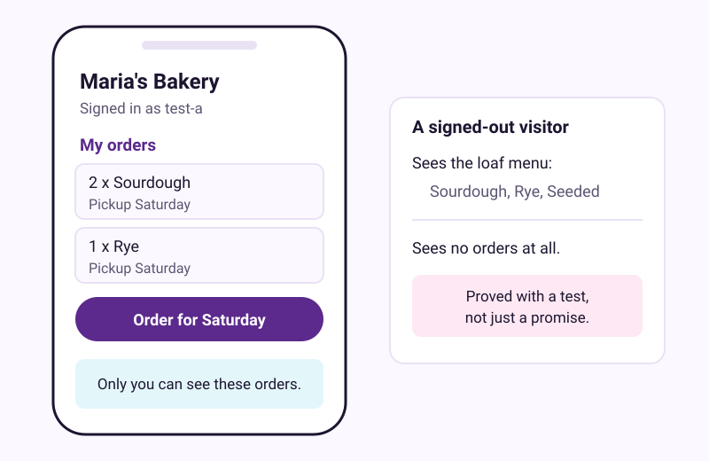
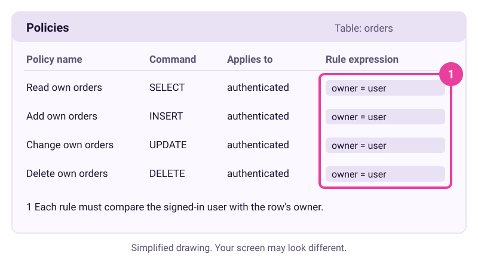
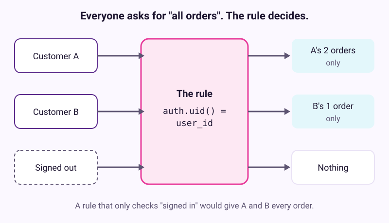
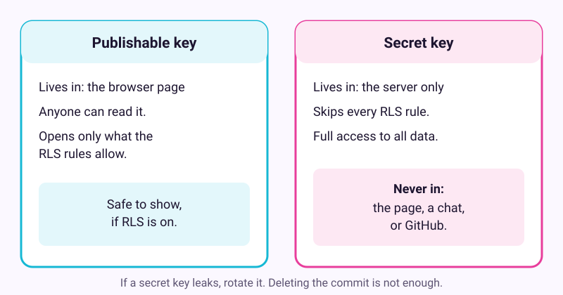

# Add logins and data without leaking them

Checked: November 2026 · Works on: Lovable Free (5 build credits a day, at most 30 a month) · Time: 60 min
You need: a free Lovable account, a second email address for a test account, and fake data only
Video version: [video script](video-script.md) (video coming later) · Next lesson: [Make a 10-second video with code](../14-video-with-code/README.md)

> **Plan check before you start.** Lovable's Free plan gives 5 build credits a day, capped at 30 a month. Lovable's own examples price "Add authentication" at about 1.2 credits and "Build a landing page with images" at about 2. A build like this one can use a few days of credits. Prices and credits change, so check your plan's help page first.

## What we'll make

In this tutorial we will make a small pre-order app for Maria's bakery. Customers sign in, order Saturday loaves, and see only their own orders. Then we will prove that nobody else can see them.



## Two words to know first

- **Row Level Security (RLS):** a database rule that decides which rows each person can read or change. Without it, anyone who finds your app's address can read the whole table.
- **Policy:** one RLS rule, such as "a signed-in customer can read an order only if they own it".

Lesson 12 showed how to publish a page with no data. This lesson adds data, so it adds risk.

## Steps

1. **Write the spec with the data rules in it.** Open a note and write one paragraph: who uses the app, what it stores, and who may see each thing. Use fake names and fake emails only.

   Maria's spec:

   ```text
   A pre-order app for a small bakery. Customers sign in with email.
   They pick a loaf (sourdough, rye or seeded), a quantity and a pickup
   Saturday. Each order is saved with the customer's user id.
   A customer can see, add, change and delete only their own orders.
   People who are not signed in can see the loaf menu and nothing else.
   No payments. No phone numbers. No addresses.
   ```

   > Check: your spec names each kind of data and says who can read it and who can change it.

2. **In Lovable: start the project and add sign-in.** Create a new project. Paste the spec into the chat box and send it. Then send: "Use Lovable's built-in sign-in and backend. Store orders with the owner's user id." The preview should show a sign-in screen.

   > Check: the preview shows a sign-in screen and a loaf menu. Yours will look different. That is normal.

   Do not paste any API key, password or card number into the chat. Lovable says secrets "cannot be stored safely in client-side code" and moves pasted keys to its **Secrets** store.

3. **In Lovable: open the Policies view.** Click **More**, then **Database**, then **Manage**, then **Policies**. You see a list with four columns: **Policy name**, **Command**, **Applies to** and **Rule expression**. Expand each row to read its rule.

   

   *Simplified drawing. Your screen may look different.*

   > Check: every table that holds orders has a policy for each command you need: SELECT (read), INSERT (add), UPDATE (change) and DELETE (remove).

4. **Read each rule for an owner check.** A safe rule compares the person asking with the row's owner. In Supabase's SQL that check often reads `auth.uid() = user_id`, though your rule may name the columns differently. A rule that only says "authenticated", or `true`, lets every signed-in person see every order. Then ask Lovable in the chat:

   ```text
   Which of my tables can people who aren't signed in read or change?
   Do any policies let every signed-in user see every row?
   ```

   > Example reply. Yours will be worded differently.
   >
   > "Signed-out visitors can read the loaves table only. The orders table has four policies. Each one checks that the signed-in user's id matches the order's user_id."

   If any rule lacks the owner check, ask: "Only allow customers to see and change their own orders." Then reopen the Policies view and read the rule again.
   > Check: every policy on the orders table compares the signed-in user with the row's owner.

   

5. **Test it with two fake customers and one stranger.** Sign up in the preview as test customer A and place two orders. Sign out. Sign up as test customer B with your second email and place one order. Then sign out and look at the app as a visitor.

   > Check: A sees only A's two orders. B sees only B's one order. A signed-out visitor sees the menu and no orders.

   The AI's answer in step 4 is a claim. This test is the proof. Do it again after every change to sign-in or to the database.

6. **In Lovable: run both security scans.** Open the project's **Security** view. Click **Run quick scan**, then **Run deep scan**. Lovable says running either scan is free. Read every finding. Fix each one, or ask Lovable to fix it, then run the scans again.

   > Check: the scan cards show no critical findings, and each card shows **Up to date**.

   A clean scan does not make the app safe. Lovable says its scans "do not replace a thorough security review". That is why steps 5 and 7 exist.

7. **Publish, then pass the eight-point checklist.** Click **Publish**. The publish dialog runs the quick scan again and shows the result on one line. Publish only if it is clean. Then go through [the eight-point checklist](#the-eight-point-checklist) below and tick every box. Finally, connect the project to GitHub so the code is yours.

   > Check: you have a live address, eight ticked boxes, and a copy of the code on GitHub.

**Another route:** Google AI Studio's Build mode can publish up to 2 full-stack apps on its free Starter Tier. Click **Publish**, then **Get Started**, then **Publish App**. Workspace accounts and anyone with a past paid Google Cloud billing account are not eligible. This lesson does not cover AI Studio's database settings, but the checklist below still applies.

## If it went wrong

- You see an empty list after signing in -> a policy matches no rows, or the order was saved without your user id -> ask Lovable "Why can't a signed-in customer see the order they just placed?"
- Customer B can see Customer A's orders -> a policy checks only "authenticated" -> ask Lovable "Only allow customers to see and change their own orders", then redo step 5.
- Lovable stops building -> you used today's build credits, or this month's 30 -> wait for tomorrow, or for the 1st of the month on Free.
- The published app stops working -> Lovable pauses apps on its own backend when credits run out -> check **Workspace settings**, then **Plans & credit usage**.
- Still stuck? Paste this into the assistant: "I'm on step {n} of a tutorial on securing a Lovable app and I see {x}. What should I check?"

## Stay safe

Keep real customers out until every box below is ticked. Never paste keys, passwords or card numbers into any chat.

### Why: real leaks from AI-built apps

| What happened | What went wrong | Source |
|---|---|---|
| CVE-2025-48757, rated 9.3 (critical): weak RLS in Lovable sites let anyone without a login read or write tables, up to 15 April 2025 | Missing or weak RLS. **Disputed by Lovable**, which says each customer is responsible for protecting their app's data | [CVE record](https://www.cve.org/CVERecord?id=CVE-2025-48757) |
| Moltbook, reported by Wiz on 2 February 2026: about 1.5 million agent API keys, 35,000 emails and private messages were readable. Posts were writable | The key in the page was the safe publishable one. RLS was not set up. The fix took several rounds | [Wiz](https://www.wiz.io/blog/exposed-moltbook-database-reveals-millions-of-api-keys) |
| Base44, July 2025: anyone could register for private apps using only the public app id | An authentication bypass on the platform, fixed within 24 hours | [SecurityWeek](https://www.securityweek.com/flaw-in-vibe-coding-platform-base44-exposed-private-enterprise-applications); [Wiz](https://www.wiz.io/blog/critical-vulnerability-base44) |
| Lovable, April 2026: chat history and code in public Lovable projects could be read by any signed-in user | A backend regression in February 2026 re-enabled access. New projects have been private by default since November 2025 | [Lovable's own post](https://lovable.dev/blog/our-response-to-the-april-2026-incident) |
| Tea app, July 2025: about 72,000 images leaked, including about 13,000 selfies and photo IDs | An unprotected legacy storage bucket. Many blamed vibe coding; **that is disputed by Simon Willison**, because the code dates from before February 2024 | [Reuters](https://www.reuters.com/sustainability/boards-policy-regulation/womens-dating-app-tea-reports-72000-images-stolen-security-breach-2025-07-26); [Willison](https://simonwillison.net/2025/Jul/26/official-statement-from-tea/) |
| Escape.tech scanned 5,600 vibe-coded apps and found over 2,000 high-impact flaws and over 400 exposed secrets | The same classes of mistake, at scale | [VentureBeat](https://venturebeat.com/security/vibe-coded-apps-shadow-ai-s3-bucket-crisis-ciso-audit-framework) |
| A Replit agent deleted SaaStr's production database during a code freeze in July 2025 | An agent with delete rights on live data. Reported through an incident log; we did not read the primary reports | [VibeIncidents](https://vibeincidents.com/) |

### The keys, in one picture



Supabase puts it simply. The publishable key is "taped to the front door" and "only opens the lobby". The secret key "is the master key, and it stays in your pocket."

### The eight-point checklist

Tick each box before any real person uses the app.

1. [ ] **Fake data first.** Use test accounts and fake orders until boxes 2 to 6 are ticked. Do not collect IDs, selfies, phone numbers or addresses you do not need.
2. [ ] **RLS on every table, scoped to the owner.** Each policy compares the user with the row's owner (`auth.uid() = user_id`), not "any signed-in user". You tested with a signed-out visitor and a second account (step 5). Storage buckets and database functions are locked down too.
3. [ ] **Only the publishable key in the page.** Secret keys, `service_role` keys and other services' keys (payments, AI) live on the server or in the platform's Secrets store. Never in HTML or JavaScript.
4. [ ] **`.env` is in `.gitignore` before the first commit.** If a key ever leaks, rotate it. Deleting the commit is not enough.
5. [ ] **The platform's own sign-in.** Use built-in auth, not home-made code. Permissions are checked in the database or on the server, never only by hiding a button. The project is private.
6. [ ] **Scanners run, then a human check.** Run the platform's scans and keep GitHub push protection on. Ask the AI to "audit this app for exposed secrets, missing RLS and unauthenticated endpoints", then check its answers by hand.
7. [ ] **No agent gets production delete rights.** Keep a backup and keep test and live data apart. Supabase Free allows 2 active projects, so you can use one for testing and one for live.
8. [ ] **The right host, with a spend cap.** No logins, passwords or card numbers on GitHub Pages. Set a spending limit on any paid tier.

## Practice on your own life

Start: pick one small list you keep about other people, such as a book club's reading list or a team's lunch orders. Goal: a signed-in app where each person sees only their own entries, with all eight boxes ticked. This time, write the policies request yourself and run the two-account test without looking back at step 5.

## What you made

You built an app that keeps each customer's orders to that customer, and you proved it with a test, not a promise. Every app with data in this kit starts from this checklist. Next, [make a 10-second video with code](../14-video-with-code/README.md).

---
Sources: [Lovable security](https://docs.lovable.dev/features/security), [Lovable database access](https://docs.lovable.dev/features/database-access), [Lovable credits](https://docs.lovable.dev/introduction/plans-and-credits), [Supabase RLS](https://supabase.com/docs/guides/database/postgres/row-level-security), [Supabase API keys](https://supabase.com/docs/guides/getting-started/api-keys), [Supabase pricing](https://supabase.com/pricing), [AI Studio deploying](https://aistudio.google.com/docs/aistudio-deploying), [GitHub push protection](https://docs.github.com/en/code-security/concepts/secret-security/push-protection), [GitHub Pages limits](https://docs.github.com/en/pages/getting-started-with-github-pages/github-pages-limits), [Masai School roundup](https://www.masaischool.com/resources/tools/free-vibe-coding-tools), plus the incident sources in the table · Screens checked: November 2026 (from Lovable's docs; we have not recorded our own screens) · Plan limits checked: 10 November 2026
