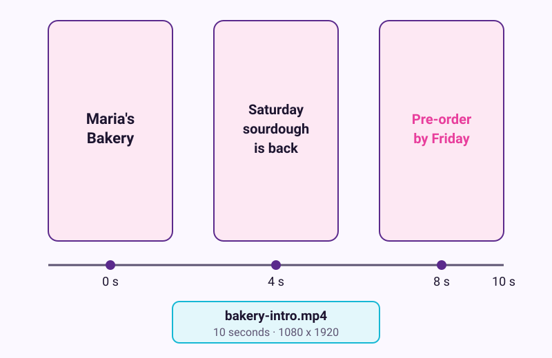
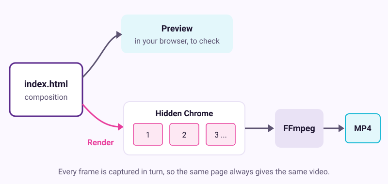
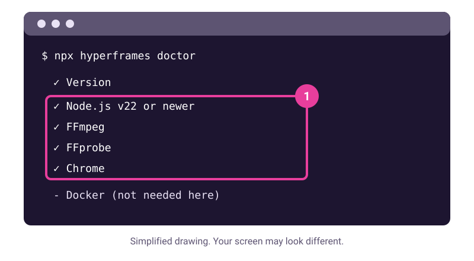

# Make a 10-second video with code

Checked: November 2026 · Works on: any computer that can install Node.js 22+ and FFmpeg, plus any free chat AI · Time: 45 min
Tested: not yet run end to end by us. These steps come from the official HyperFrames quickstart, CLI guide and FAQ, read on 10 November 2026.
You need: a Mac, Windows or Linux computer where you can install programs, a terminal, and a free account with any chat AI
Video version: [video script](video-script.md) (video coming later) · Next lesson: [Spot hype and keep learning](../15-spot-hype-keep-learning/README.md)

> **Cost check before you start.** HyperFrames is open source (Apache 2.0). Rendering on your own computer is free and needs no account, according to its FAQ. HeyGen voices, avatars, cloud rendering and the hosted chat connector are paid extras through a HeyGen account. This lesson uses none of them.

## What we'll make

In this tutorial we will make a 10-second vertical video for Maria's bakery Instagram. It says "Saturday sourdough is back" and "Pre-order by Friday". An AI writes the video as a web page, and your computer turns it into an MP4.



## Two words to know first

- **Composition:** the web page that describes your video. In HyperFrames it is a file called `index.html`.
- **Render:** turning the composition into a video file. HyperFrames opens the page in a hidden Chrome browser, moves to each frame in turn, and FFmpeg joins the frames into an MP4.



Screen recording is not a shortcut here. One test found only about 9 real frames per second in a 25 frames-per-second browser recording. Stepping frame by frame avoids that.

## Steps

1. **Install Node.js and FFmpeg.** Download Node.js version 22 or newer from [nodejs.org](https://nodejs.org). Install FFmpeg from [ffmpeg.org](https://ffmpeg.org/download.html) or your system's package manager. Open a new terminal window and type `node --version`.

   > Check: the terminal prints a version that starts with `v22` or a higher number.

2. **Create the project.** In the terminal, run these lines one at a time:

   ```bash
   npx hyperframes init bakery-intro --resolution portrait
   cd bakery-intro
   npx hyperframes telemetry disable
   ```

   The first line makes a folder with a 1080 by 1920 portrait canvas. If it asks questions, such as which example to start from, choose the blank one. The last line turns off the anonymous usage data the tool sends by default.

   > Check: the `bakery-intro` folder holds `index.html`, `AGENTS.md`, `CLAUDE.md` and `hyperframes.json`.

   `npx` downloads the HyperFrames tool and runs it. Type the name exactly as shown, so you get the official package.

3. **Check your computer.** Run `npx hyperframes doctor`. It lists each thing HyperFrames needs, with a tick or a cross.

   

   *Simplified drawing. Your screen may look different.*

   > Check: Node.js, FFmpeg, FFprobe and Chrome all show a tick. Docker is not needed for this lesson.

4. **Brief a free chat AI.** First copy `index.html` to `index-original.html`, so you can go back. Open your chat AI. Paste the request below, then paste the full text of `AGENTS.md` and `index.html` under it.

   ```text
   I'm making a 10-second video with HyperFrames, which renders an HTML
   page to MP4. Below are AGENTS.md, which explains the format, and my
   current index.html. Rewrite index.html as a 10-second, 1080x1920
   portrait video for a small neighbourhood bakery:
   0-3 s: "Maria's Bakery" fades in on a warm cream background.
   3-7 s: "Saturday sourdough is back" slides up.
   7-10 s: "Pre-order by Friday" appears, then holds.
   Keep the HyperFrames structure and data attributes from my file.
   Use CSS animation only. No outside images, fonts or scripts.
   Return the whole file in one code block.
   ```

   Save the reply's code over `index.html`.

   > Example reply. Yours will be worded differently.
   >
   > "Here is the updated index.html. I kept the root composition element and its timing attributes, and added three text layers with CSS keyframes..." followed by one code block.

   > Check: the reply has one code block that starts with `<!doctype html>` or `<html`, and your new `index.html` contains all three lines of text.

5. **Lint it, then preview it.** Run `npx hyperframes lint`. If it lists errors, paste them into the same chat and ask for a fixed file. When lint is clean, run `npx hyperframes preview`. A preview opens in your browser.

   > Check: the preview plays for about 10 seconds and shows the three lines in order.

   Ask for one change at a time, such as "Make the last line twice as big." Save, lint and preview again after each one.

6. **Render the MP4.** Stop the preview with Ctrl+C. Run:

   ```bash
   npx hyperframes render --output bakery-intro.mp4
   ```

   For a faster test render, add `--quality draft` to the end of that line.

   > Check: `bakery-intro.mp4` is in the folder, plays for 10 seconds, and is taller than it is wide.

7. **Watch it before you post it.** Play the MP4 from start to end. Check spelling, dates and timing, because the AI can get them wrong. Any font, music or footage you add keeps its own licence, so use only what you may share.

   > Check: you watched the whole video once, and every word on screen is right.

**If you already use a coding agent:** HyperFrames ships skills for agents such as Claude Code and Codex. The quickstart says to run `npx hyperframes skills update` in the folder and restart the agent. Then ask: "Using /hyperframes, make a 10-second product intro for https://example.com". Replace the address with your own page. The free **Studio app** is a third way, and needs a free HeyGen account.

## If it went wrong

- `npx` or `node` is "not found" -> Node.js is missing, or the terminal opened before you installed it -> install Node.js 22+ and open a new terminal.
- Doctor shows a cross next to FFmpeg -> FFmpeg is not installed or not on your path -> reinstall it, open a new terminal, and rerun doctor.
- The preview is blank or lint shows errors -> the AI changed the HyperFrames structure -> paste the lint output into the chat and ask for a fix.
- The render is very slow -> long, large or effect-heavy videos take longer -> render with `--quality draft` while you test. HyperFrames' help page covers slow renders under WSL2 on Windows.
- Still stuck? Run `npx hyperframes doctor`, `npx hyperframes lint` and `npx hyperframes check`. Paste the output into the assistant with: "I'm on step {n} of a HyperFrames tutorial and I see {x}. What should I check?"

## Stay safe

- `npx` runs code from the internet on your computer. Run only commands from the official HyperFrames docs, and type the package name exactly.
- Local preview and render keep the project on your computer. Cloud rendering and the hosted connector upload it to HeyGen. Your chat AI receives whatever you paste, so keep private details out of the brief.

**Other free tools.** Remotion is the more mature option and uses React. It is free for individuals and companies of up to three people; larger companies need a paid Company License. Manim (MIT licence, Python) suits maths explainers.

## Practice on your own life

Start: pick one thing you want to announce, such as a club meeting, a sale or a birthday. Goal: a 10-second MP4 you made with a new `init` folder. This time, write the brief yourself, in square format with `--resolution square`, and get it to a clean lint before you preview.

## What you made

You turned a short brief into a real video file on your own computer, with no editing app and no paid account. You can now make promos and title cards from plain text. Next, [spot hype and keep learning](../15-spot-hype-keep-learning/README.md).

---
Sources: [HyperFrames quickstart](https://hyperframes.heygen.com/quickstart), [HyperFrames CLI guide](https://hyperframes.heygen.com/developers/cli), [HyperFrames CLI reference](https://hyperframes.heygen.com/packages/cli), [HyperFrames FAQ](https://hyperframes.heygen.com/faq), [HyperFrames on GitHub](https://github.com/heygen-com/hyperframes), [HyperFrames with a free agent](https://hyperframes.heygen.com/guides/free-agents), [Remotion license](https://companies.remotion.dev/license), [Remotion docs](https://www.remotion.dev/docs), [Manim on PyPI](https://pypi.org/project/manim), [frame-rate test on Medium](https://medium.com/@ayoub.hammoudi05/playwright-recorded-my-25-fps-animation-at-about-9-the-fix-was-to-stop-recording-26589e7cae03) · Screens checked: not recorded; drawings are generic · Plan limits checked: 10 November 2026 · Tested: not yet run end to end by us
