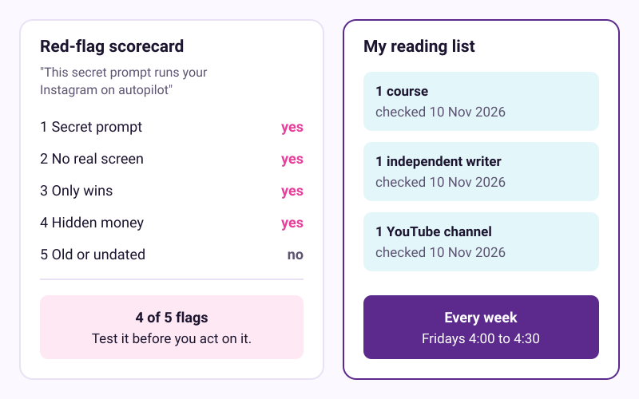
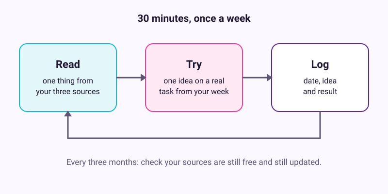

# Spot hype and keep learning

Checked: November 2026 · Works on: any free chat AI with web search, and a web browser · Time: 30 min, then 30 min a week
You need: one AI video or post you were about to trust, a notes app, and your calendar
Video version: [video script](video-script.md) (video coming later) · Next lesson: this is the last lesson. Go back to [the start](../01-first-useful-conversation/README.md) when you want a refresher.

> **Cost check.** Everything in this lesson is free. The resource list below marks what is free, what is partly free, and what only looks free. Prices were checked on 10 November 2026.

## What we'll make

In this tutorial we will make two things. The first is a red-flag scorecard you can use on any AI video or post. The second is a short reading list of three trusted free sources, with a weekly slot to use them.



## Two words to know first

- **Hype:** a claim that sounds bigger than the evidence shown for it.
- **Primary source:** the original page, such as the maker's help page or the study itself, not someone's summary of it.

## Steps

1. **Pick one thing you were about to trust.** Choose one AI video, post or newsletter you saw this week. Maria picks a video called "This secret prompt runs your bakery's Instagram on autopilot". Copy its title and link into a new note.

   > Check: your note has one title and one link.

2. **Score it against the five red flags.** Write yes or no next to each flag.

   

   - **Flag 1: A "secret" or "magic" prompt.** A 2026 channel guide calls "secret prompt" framing a red flag. The makers' own courses teach clear briefing and checking, not magic words.
   - **Flag 2: No real screen, no real prompt.** The same guide says to prefer videos that "show the actual screen and the actual prompt used". Big view counts and star counts do not count as evidence either.
   - **Flag 3: Only wins.** The writers worth trusting report failures. Ethan Mollick called one model's first course website "accurate and joyless".
   - **Flag 4: Hidden money.** Sponsors and paid tiers are fine if they are disclosed. A "free" course that ends in a pushy sales webinar, or a "free" certificate that costs money, is not.
   - **Flag 5: Old or undated.** Andrej Karpathy says December 2025 was an "agentic inflection point", after which "you really had to look again". Treat undated or older tool tours as history.

   > Check: you have five yes-or-no answers. The more yeses, the less you should act on it without testing it first.

3. **Ask an AI to pull out the claims, then check one yourself.** Paste the post's text or the video's transcript into a chat AI with web search turned on. Send:

   ```text
   List every factual claim in this text as a numbered list.
   For each one, say what evidence the text itself gives, if any.
   Then search the web for the claim that matters most and link
   the primary source. Say plainly if you cannot find one.
   ```

   > Example reply. Yours will be worded differently.
   >
   > "1. 'This prompt posts for you every day.' Evidence given: none shown. 2. 'Works on the free plan.' Evidence given: none. ... For claim 2, I found the maker's help page, which says scheduled tasks on the free plan are limited..."

   Open the link the AI gives you and read the page yourself. The AI can misread a page too.

   > Check: you have a numbered list of claims, and you opened one primary source with your own eyes.

4. **Test one useful idea on a real task.** Take the one idea that survived step 3. Try it for 15 minutes on something real from your week. Maria tries "ask the AI to improve my request" on her Saturday sourdough post. Write down what happened.

   Karpathy's advice is "neither dismissal nor blind trust" but "empirical familiarity". Mollick suggests about 10 hours of hands-on use to get the feel of AI.

   > Check: your note has one line saying what you tried and whether it helped.

5. **Pick your three sources.** From [the list below](#best-free-resources-checked-10-november-2026), choose one course, one independent writer and one YouTube channel. Three is enough. Write each one's link and the date you checked it into your note.

   

   > Check: your reading list has exactly three items, each with a link and a date.

6. **Book a weekly slot.** In your calendar, make a 30-minute event that repeats every week. Call it "AI: read, try, log". Maria picks Fridays at 4:00, after the Saturday orders are in. If you use the kit's **weekly-review** skill, add "What did I learn about AI this week?" to it.

   > Check: the event repeats weekly, and its notes hold the link to your reading list.

7. **Keep a "tried it" log and date it.** Each week, add one line to your note: the date, the idea, and the result. Every three months, check that your three sources are still free and still updated. AI tools changed several times in 2026 alone, so the date matters.

   > Check: your note has today's line, and a reminder three months from now.

## If it went wrong

- The AI finds no source for any claim -> there may be none, or search is off -> turn web search on, or check the maker's help pages.
- Every video you check scores four or five flags -> you may be watching news and reaction channels -> switch to one of the YouTube picks below. News channels are "useful for staying current, not especially useful for building skill".
- You skip the weekly slot -> 30 minutes is too long for this week -> do 10 minutes and log one line. The habit matters more than the length.
- Still stuck? Paste this into the assistant: "I'm on step {n} of a tutorial on judging AI content and I see {x}. What should I check?"

## Stay safe

Never pay for a course from a sales webinar on the same day. Never paste passwords, card numbers or private messages into a chat to "test" a claim.

## Practice on your own life

Start: open the last AI post a friend or colleague sent you. Goal: a scored scorecard and one tested idea in your log. This time, write the claim-finding request yourself, without looking at step 3.

## What you made

You can now tell a careful source from a loud one in a few minutes. You also have a small, dated reading habit that keeps you current. That closes this series. Come back to any lesson when a tool changes, and check its date first.

## Best free resources (checked 10 November 2026)

Prices, badges and update dates change. Each line shows what we saw on the date above.

### Official academies

| Resource | What it teaches best | Cost and level |
|---|---|---|
| [AI Fluency: Framework and foundations](https://academy.claude.com/courses/ai-fluency-framework-foundations) (Anthropic) | How to decide, describe, check and own AI work, in any tool | Free, with a free badge. 14 lessons, about 4 hours, no code |
| [AI capabilities and limitations](https://academy.claude.com/courses/ai-capabilities-and-limitations) (Anthropic) | Why AI goes wrong and how to fix it | Free, with a free badge. 13 lessons, about 3.5 hours, no technical background |
| [OpenAI Academy Foundations pathway](https://academy.openai.com/public/courses/ai-foundations-juzjs) | Practising good habits on your own real task, then workflows and agents | Free with a ChatGPT account. Badge at 80% or more on the quiz. About 4 hours. The agents course needs agent access |
| [Claude 101](https://academy.claude.com/courses/claude-101) (Anthropic) | A tour of Claude: projects, skills, connectors, research | Free, with a free badge. About 2.5 hours. Some features need a paid plan |
| [AI Prompting for Everyone](https://www.deeplearning.ai/courses/ai-prompting-for-everyone) (DeepLearning.AI) | Web search with sources, deep research, AI as a critic | Videos free, about 7 hours. Quizzes, labs and certificate need Pro. Updated 24 July 2026 |
| [Build foundational generative AI skills](https://learn.microsoft.com/en-us/training/paths/explore-microsoft-365-copilot-business-chat) (Microsoft Learn) | Protect sensitive data, verify, own the result | Free. Dated 2 September 2026. Built around Copilot |
| [Introduction to Generative AI](https://www.skills.google/course_templates/536) (Google Skills) | A 45-minute orientation to what generative AI is | Free, with a badge |
| [Prompting guide 101](https://workspace.google.com/resources/ai/writing-effective-prompts) (Google Workspace) | A simple request formula: persona, task, context, format | Free to read online |

### Independent writers

| Resource | What it teaches best | Cost and level |
|---|---|---|
| [Ethan Mollick, One Useful Thing](https://www.oneusefulthing.org), plus his [Summer 2026 guide to which AI to use](https://www.oneusefulthing.org/p/an-opinionated-guide-to-which-ai-b22) | Which AI to pick, the "jagged frontier", managing agents with approvals on | Free newsletter. Non-technical. Latest post seen 9 November 2026 |
| [Simon Willison's blog](https://simonwillison.net) and [Agentic Engineering Patterns](https://simonwillison.net/guides/agentic-engineering-patterns/) | Context, testing, and prompt-injection risks such as the "lethal trifecta" | Free, with sponsor banners. Intermediate. Posts almost daily |
| [Andrej Karpathy's blog](https://karpathy.bearblog.dev) | Mental models: jagged intelligence, "automate what you can verify" | Free. Some posts are technical |
| [Hamel Husain on evals](https://hamel.dev/blog/posts/evals-faq/) | Look at your outputs before you trust any automated check | Free writing. For builders. He also sells a paid course |

### YouTube

| Channel | Best for | Notes |
|---|---|---|
| [Jeff Su](https://www.youtube.com/@JeffSu) | Plain-language AI for office work and personal agents | Absolute beginners. Has sponsored segments |
| [Andrej Karpathy, General Audience videos](https://www.youtube.com/@AndrejKarpathy) | How large language models work, with "no programming experience necessary" | Free. Made 1 to 2 years ago, before the agent shift, so the tool tours are dated |
| [Tina Huang](https://www.youtube.com/@TinaHuang1) | Learning roadmaps and tool basics | Beginner to intermediate. Sponsored, and promotes a paid bootcamp |
| [AI Explained](https://www.youtube.com/@aiexplained-official) | Careful analysis of new model releases | News and analysis, not tutorials. Latest upload date not confirmed |

**Reference only:** [promptingguide.ai](https://www.promptingguide.ai) and the [Learn Prompting docs](https://learnprompting.org/docs/introduction) for background on techniques, some of them 2023-era tricks. [prompts.chat](https://github.com/f/prompts.chat) for ideas. One reviewer warns the risk "starts when you mistake stars, likes and polished wording for reliability".

**Next steps for builders:** Microsoft's [Generative AI for Beginners](https://github.com/microsoft/generative-ai-for-beginners), Kaggle's [5-Day AI Agents course](https://www.kaggle.com/learn-guide/5-day-agents) and the Hugging Face courses are free and good. They need Python, though.

## What's not really free

| Resource | The catch |
|---|---|
| [Google AI Essentials](https://grow.google/ai-essentials) and Google Prompting Essentials | $49 a month after a 7-day free trial in the US and Canada. Financial aid is available |
| [DeepLearning.AI](https://www.deeplearning.ai/blog/introducing-deeplearning-ai-pro) courses | Videos are free. Quizzes, labs and certificates need Pro, at $25 a month billed yearly or $30 monthly |
| AI for Everyone certificate | The videos are free on DeepLearning.AI. The certificate costs $49 on Coursera |
| [Learn Prompting](https://learnprompting.org/courses/chatgpt-for-everyone) courses | The docs are free. Courses sit in the paid "Plus" catalogue, after a 3-day trial |
| [promptingguide.ai](https://www.promptingguide.ai) | Pages are free, with a banner selling a paid course |
| Claude Code courses | The courses are free. The tool itself needs a paid Claude plan |
| OpenAI Academy's Agents and Workflows course | The course is free, but it needs "access to agent capabilities", which may mean a paid plan |
| Peter Yang's Behind the Craft, Hamel Husain's course | Many Behind the Craft guides are paywalled. Hamel's writing is free; his cohort course is paid |
| "Free" badges | Badges are not certifications. OpenAI says its Academy badges are "not certifications" |
| Paid beginner AI courses sold through webinars | Reviewers report content "comparable to what is already available on YouTube" and high-pressure upsells |

---
Sources: [AIVX Labs channel guide](https://aivxlabs.com/best-youtube-channels-to-learn-ai), [One Useful Thing](https://www.oneusefulthing.org), [Mollick, Fable 5.2 and Jagged AGI](https://www.oneusefulthing.org/p/fable-52-and-jagged-agi), [Stanford GSB on Mollick](https://www.gsb.stanford.edu/insights/co-intelligence-ai-masterclass-ethan-mollick), [Willison](https://simonwillison.net), [Karpathy, Sequoia Ascent 2026](https://karpathy.bearblog.dev/sequoia-ascent-2026/), [AI Dreamhub review](https://aidreamhub.com/ko/tools/awesome-chatgpt-prompts), [OpenAI Academy help](https://help.openai.com/en/articles/20001270), [Claude Academy](https://academy.claude.com/courses), [Reddit review of a paid course](https://www.reddit.com/r/learnmachinelearning/comments/1mymw0q/growth_school_and_outskill_scam), [Reddit on upsell webinars](https://www.reddit.com/r/AI_India/comments/1qv14o8/dont_buy_growthschools_ai_course), [Coursera reviews](https://www.coursera.org/learn/google-introduction-to-ai/reviews), plus every link in the two lists above · Screens checked: none needed · Plan limits checked: 10 November 2026
